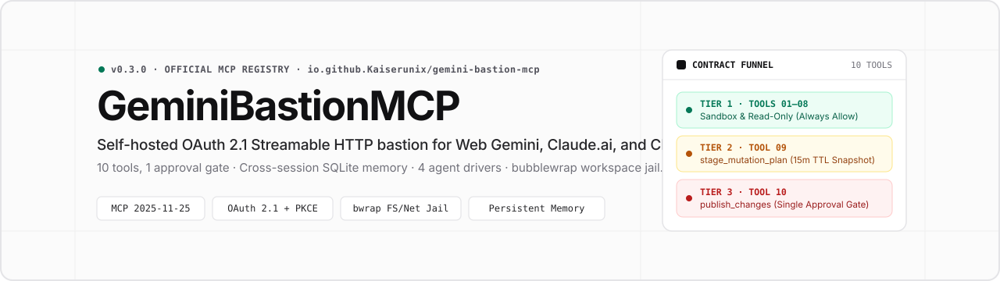
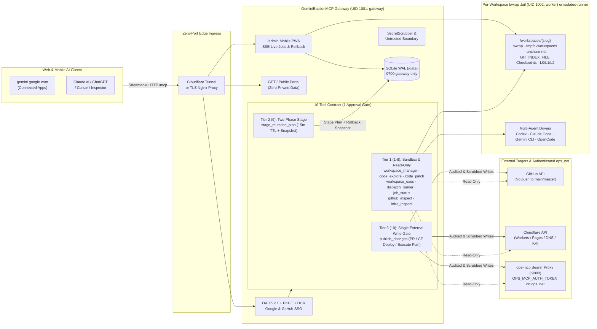
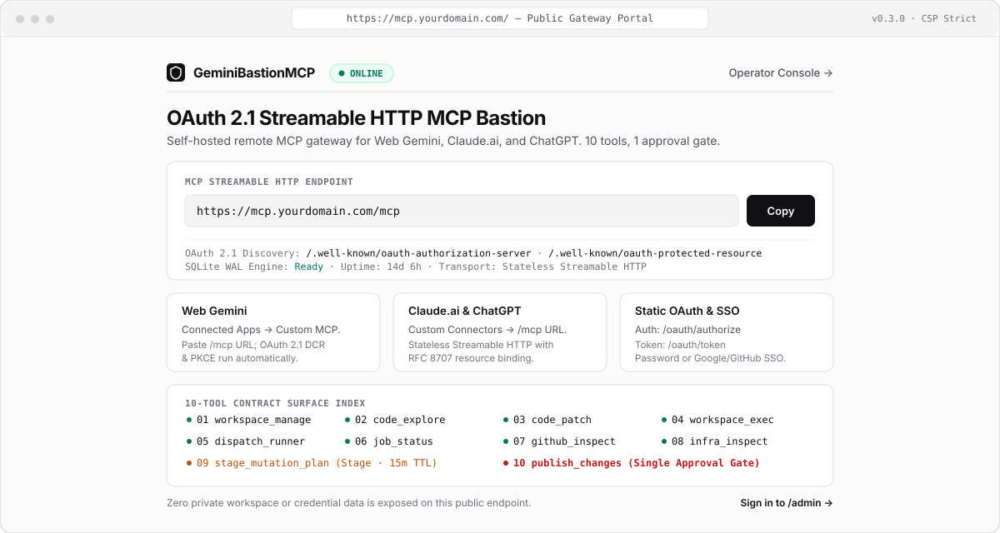
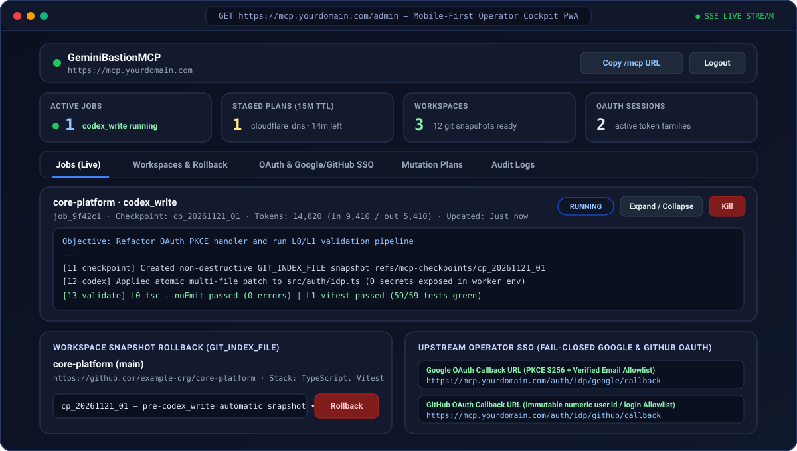

<p align="center">
  
</p>

<div align="center">

# GeminiBastionMCP (`gemini-bastion-mcp`)

**Built for Web Gemini (`gemini.google.com`) Connected Apps, Claude.ai Custom Connectors & ChatGPT MCP Connectors — NOT Gemini-Only.**

[](https://github.com/Kaiserunix/gemini-bastion-mcp/actions/workflows/ci.yml)
[](https://github.com/Kaiserunix/gemini-bastion-mcp/actions/workflows/docker-publish.yml)
[](https://kaiserunix.github.io/gemini-bastion-mcp/)
[](CHANGELOG.md)
[%20%7C%20full-0ea5e9?style=flat-square)](https://github.com/Kaiserunix/gemini-bastion-mcp/pkgs/container/gemini-bastion-mcp)
[](server.json)
[](docker/Dockerfile)
[](https://modelcontextprotocol.io)
[](#connecting-ai-clients)
[](https://github.com/Kaiserunix/gemini-bastion-mcp/issues/new/choose)
[](LICENSE)

**English | [简体中文](README.zh-CN.md)**

[Live Showcase](https://kaiserunix.github.io/gemini-bastion-mcp/) · [Why This Exists](#why-this-exists) · [Architecture](#architecture-overview) · [10 Tools](#10-tools-1-approval-gate) · [Multi-Agent Drivers](#pluggable-multi-agent-drivers) · [Quick Start](#1-minute-quick-start-ghcr-zero-build) · [Security v2](#security-architecture-v2-6-layer-defense-in-depth) · [MCP Registry](#official-mcp-registry--ghcr-images)

</div>

---

- **100% Standard Remote MCP for Web Gemini, Claude.ai & ChatGPT**: Named `GeminiBastionMCP` because it conquered `gemini.google.com` Connected Apps' strict OAuth 2.1 DCR rules first (16 redirect URIs, 8KB `state`, RFC 8707/9728) — while speaking pure **MCP 2025-11-25 Streamable HTTP** for **Claude.ai Custom Connectors, ChatGPT MCP Connectors, Cursor & MCP Inspector**.
- **Code, Test & Deploy from Mobile or Any Browser**: Sync GitHub repos, explore AST/files (`ripgrep`, `ast-grep`, `repomix`), apply atomic multi-file patches, and run L0/L1/L2 checks inside a **per-workspace `bwrap` FS & network jail** (`--unshare-net` by default).
- **Pluggable Multi-Agent Drivers & 1-Gate Blast Radius**: Delegate background tasks to **OpenAI Codex SDK**, **Claude Code CLI**, **Gemini CLI**, or **OpenCode CLI** (`workspace_exec` auto-promotes after 15s), with **zero gateway secret leakage** and every external write funneled through **one single approval gate (`publish_changes`)**.

> [!TIP]
> **Skip the build!** Pull pre-built multi-variant GHCR images (`ghcr.io/kaiserunix/gemini-bastion-mcp:lite` ~350MB or `:full`) and launch in under 60 seconds with `docker compose pull && docker compose up -d`.

---

## Why This Exists

Most Remote MCP Servers force an unpleasant tradeoff: either expose dozens of fine-grained tools (triggering endless confirmation popups on every file read or test run) or run an unguarded shell directly on your host.

| Capability | **GeminiBastionMCP (`v0.2.0`)** | Generic Proxies (e.g. MetaMCP) | Official Remote MCPs (GitHub / CF) | Local Shell / Stdio MCP |
| :--- | :--- | :--- | :--- | :--- |
| **Web Gemini, Claude.ai & ChatGPT OAuth 2.1 DCR** | **Full Support** (PKCE `S256`, DCR up to 16 redirect URIs, 8KB `state`, RFC 8707/9728) | Often missing RFC 9728/8707 or large `state` support | Single-vendor hosted only | Desktop/local client only |
| **Web & Mobile Approval UX** | **10 Tools, 1 Approval Gate** (Tier 1/2 `Always Allow`, only `publish_changes` asks) | Dozens of fragmented tools = constant confirmation popups | Read & write tools mixed | Confirm every shell command or run wide open |
| **Multi-Agent Runners + `bwrap` Sandbox** | **Built-in** (`codex`, `claude_code`, `gemini_cli`, `opencode` + per-workspace `bwrap --unshare-net`) | No execution sandbox | API-only; cannot run builds/tests | Runs on host; no background job promotion |
| **Secret Isolation & Non-Destructive Undo** | **Dual-UID (1001/1002) + Optional `isolated-runner` + `SecretScrubber` + `GIT_INDEX_FILE`** | Depends on downstream servers | Cloud-managed | Child processes inherit host env |
| **Two-Phase Infra & Authenticated Sidecar** | **`stage_mutation_plan` (15m TTL + rollback) -> `publish_changes` + Bearer-auth `ops-mcp`** | Direct passthrough writes | Direct writes | None |

---

## Architecture Overview



---

## 10 Tools, 1 Approval Gate

Instead of exposing 40+ granular tools that bury mobile/web users under approval prompts, `GeminiBastionMCP` groups capabilities by **blast radius** so you can configure client permissions cleanly:

### Tier 1 — Sandbox Autonomy & Read-Only Inspection *(Set to `Always Allow`)*

| # | Tool | Actions & Behavior |
|---|------|--------------------|
| 1 | `workspace_manage` | `list`, `sync_github`, `init_cf_ops`, `list_checkpoints`, `rollback` (auto-detects stack & `AGENTS.md` / `CLAUDE.md`) |
| 2 | `code_explore` | `pack` (repomix), `search` (ripgrep), `ast` (ast-grep), `read_lines`, `read_artifact`, `git_diff` |
| 3 | `code_patch` | Atomic multi-file `patch` (`hunks` + `line_hint`), `create_or_overwrite`, `delete_file` with auto-checkpoint + L0/L1/L2 validation |
| 4 | `workspace_exec` | Sandboxed shell inside per-workspace `bwrap` jail (`--unshare-net` default; opt-in `allow_network: true`; `wait_ms` up to `15000`; auto-promotes to background SQLite `job_id`) |
| 5 | `dispatch_runner` | Background `codex_readonly` / `codex_write` / `agent_readonly` / `agent_write` / `shell_task` with pluggable `agent_driver` (`codex`, `claude_code`, `gemini_cli`, `opencode`), thread resume, budgets, and auto-checkpoint |
| 6 | `job_status` | Poll job status, streamed events, token usage, `thread_id`, `git status -sb`, final report, or `cancel: true` |
| 7 | `github_inspect` | Read-only PR diffs/files, issue threads, and failed Actions logs (wrapped with untrusted-data boundary markers) |
| 8 | `infra_inspect` | Read-only Cloudflare inspection (`zones`, `dns_records`, `workers`, `pages`, `kv_namespaces`, `d1_databases`, `waf_rules`, `worker_tail_logs`) + downstream MCP-2 `readonlyTools` |

### Tier 2 — Zero-Side-Effect Change Staging *(Set to `Always Allow`)*

| # | Tool | Actions & Behavior |
|---|------|--------------------|
| 9 | `stage_mutation_plan` | Captures pre-change live state to build a `rollback_payload` and human-readable diff, issuing a 15-minute `plan_id` for Cloudflare or downstream MCP-2 `mutatingTools`. **Performs zero writes.** |

### Tier 3 — Single External Write Gate *(Set to `Ask Before Running`)*

| # | Tool | Actions & Behavior |
|---|------|--------------------|
| 10 | `publish_changes` | **The ONLY external write exit**: `github_pr` (blocks direct push to `main`/`master`/default), `github_pr_review`, `github_comment`, `cloudflare_worker_deploy` (preview URL default), `cloudflare_pages_deploy`, `execute_staged_plan`, `rollback_plan`. |

---

## Pluggable Multi-Agent Drivers

Set a default driver via `DEFAULT_AGENT_DRIVER` in `.env` or select one per job with `dispatch_runner` (`runner_type: "agent_readonly" | "agent_write"`, `agent_driver`):

| Driver (`agent_driver`) | Engine / CLI | Required Secret (Isolated to Runner Only) | Read-Only vs Write Mode |
| :--- | :--- | :--- | :--- |
| `codex` *(default)* | `@openai/codex-sdk` | `OPENAI_API_KEY` or `CODEX_API_KEY` | `read-only` / `workspace-write` |
| `claude_code` | `claude -p --output-format stream-json` | `ANTHROPIC_API_KEY` | `--permission-mode plan` / `acceptEdits` |
| `gemini_cli` | `gemini -p ... --output-format stream-json` | `GEMINI_API_KEY` | `--approval-mode plan` / `yolo` |
| `opencode` | `opencode run --format json` | Provider API key(s) | Read-only / write objective execution |

---

## Visual UI Preview

<table>
  <tr>
    <td width="50%" align="center">
      
      <br />
      <sub><strong>Public Gateway Portal (<code>GET /</code>)</strong> — Zero-data-leak status page with one-click <code>/mcp</code> copy, <code>.well-known</code> links &amp; JSON content negotiation.</sub>
    </td>
    <td width="50%" align="center">
      
      <br />
      <sub><strong>Mobile Operator Cockpit (<code>/admin</code> PWA)</strong> — 4-KPI Pulse Strip, SSE live job streaming, one-click <code>Kill</code> / <code>Rollback</code> confirmations &amp; scrubbed audit trail.</sub>
    </td>
  </tr>
</table>

---

## 1-Minute Quick Start (GHCR Zero-Build)

[`docker/docker-compose.yml`](docker/docker-compose.yml) runs `gateway` with **zero host ports exposed** (`expose: ["8787"]` only), pulling pre-built GHCR images in seconds (`lite` ~350MB by default, or `full` with Python 3.12 + `uv`, `mise`, `ruff`, `biome`, `pyright`, `ast-grep`, `repomix`, `shellcheck`, `hadolint`, `actionlint`, `gitleaks`, `gh`, `wrangler`).

### Option A: Zero-Build GHCR Pull + Cloudflare Tunnel (Recommended)

1. **Pull directly or clone the Compose stack**:
   ```bash
   docker pull ghcr.io/kaiserunix/gemini-bastion-mcp:lite
   # Or full workbench image:
   # docker pull ghcr.io/kaiserunix/gemini-bastion-mcp:full

   git clone https://github.com/Kaiserunix/gemini-bastion-mcp.git
   cd gemini-bastion-mcp
   cp .env.example .env
   ```

2. **Generate `ADMIN_PASSWORD_HASH` (`scrypt:`) and `OAUTH_SIGNING_SECRET`**:
   Supported formats in production are `scrypt:<saltHex>:<keyHex>` (recommended, Docker-Compose-safe without `$` escaping) and `sha256:<hex>` (legacy `scrypt$<saltHex>$<keyHex>` / `sha256$<hex>` are also supported; escape `$` as `$$` in Docker Compose `.env`):
   ```bash
   node -e 'const c=require("node:crypto"),s=c.randomBytes(16).toString("hex");console.log(`scrypt:${s}:${c.scryptSync(process.argv[1],s,32,{N:16384,r:8,p:1}).toString("hex")}`)' 'your-admin-password'
   ```
   ```bash
   node -e 'console.log(require("node:crypto").randomBytes(32).toString("hex"))'
   ```

3. **Set core values in `.env`**, point your Cloudflare Tunnel Public Hostname (`mcp.yourdomain.com`) to `http://gateway:8787`, put `CLOUDFLARE_TUNNEL_TOKEN=<token>` in `docker/.env` (or export it in your shell), and start in 30 seconds:
   ```bash
   docker compose -f docker/docker-compose.yml pull
   docker compose -f docker/docker-compose.yml up -d
   ```
   To switch to the `:full` toolchain image, set `BASTION_IMAGE_TAG=full` in `docker/.env` (or build locally with `BASTION_TARGET=runtime-full docker compose -f docker/docker-compose.yml up -d --build`).

> [!IMPORTANT]
> **Node 22 Security Baseline**: Both `runtime-lite` and `runtime-full` in [`docker/Dockerfile`](docker/Dockerfile) enforce `Node >= 22.23.4` at build time. `cloudflared` receives only `TUNNEL_TOKEN` (never mounts `../.env`).

<details>
<summary><strong>Environment Variable Reference (.env)</strong></summary>

| Variable | Purpose |
| :--- | :--- |
| `PUBLIC_DOMAIN` | Exact HTTPS origin of your gateway (e.g. `https://mcp.yourdomain.com`) |
| `TRUST_CF_CONNECTING_IP` | `true` behind Cloudflare Tunnel/CDN; `false` behind standalone Nginx |
| `OAUTH_SIGNING_SECRET` | `>= 32`-character random hex/base64 secret (`NODE_ENV=production` rejects placeholders) |
| `ADMIN_PASSWORD_HASH` | `scrypt:<saltHex>:<keyHex>` (recommended) or `sha256:<hex>` |
| `OAUTH_STATIC_CLIENT_ID` / `_SECRET` | Optional static OAuth client credentials (fallback for non-DCR clients) |
| `GOOGLE_OAUTH_*` / `GITHUB_OAUTH_*` | Optional fail-closed upstream operator SSO credentials + allowlists |
| `SANDBOX_BWRAP_ISOLATION` | Enable per-workspace `bwrap` FS & `--unshare-net` jail (default `true` on Linux) |
| `SANDBOX_STRICT_ISOLATION` | Fail closed if `bwrap` cannot create namespaces (default `false`) |
| `DEFAULT_AGENT_DRIVER` | Default runner driver: `codex` (default), `claude_code`, `gemini_cli`, `opencode` |
| `AGENT_RUNNER_URL` / `_AUTH_TOKEN` | Optional dedicated `isolated-runner` sidecar URL + Bearer secret (`>= 24` chars) |
| `OPS_MCP_AUTH_TOKEN` | Bearer token (`>= 24` chars) protecting `ops-mcp` sidecar |
| `GH_TOKEN` | GitHub PAT (gateway-only; never exposed to `workspace_exec` or agents) |
| `CLOUDFLARE_ACCOUNT_ID` / `_READONLY_API_TOKEN` / `_API_TOKEN` | Cloudflare account + split read-only vs write tokens |
| `OPENAI_API_KEY` / `CODEX_API_KEY` / `ANTHROPIC_API_KEY` / `GEMINI_API_KEY` | Agent driver API credentials |
| `NOTIFY_WEBHOOK_URL` | Optional webhook endpoint for scrubbed job & plan alerts |
| `DOWNSTREAM_MCPS_FILE` / `_JSON` | Optional downstream MCP-2 federation registry |

</details>

### Option B: Reverse Proxy with Nginx (Loopback Host Port)

Bind `gateway` strictly to loopback (`127.0.0.1:8787:8787` or `127.0.0.1:39120:8787`) via a `docker-compose.override.yml`, set `TRUST_CF_CONNECTING_IP=false` in `.env`, and run `gateway` without `cloudflared`:

```bash
docker compose -f docker/docker-compose.yml up -d gateway
```

<details>
<summary><strong>Nginx Reverse Proxy Config (Streamable HTTP, SSE &amp; 8KB OAuth State)</strong></summary>

```nginx
server {
  listen 443 ssl http2;
  server_name mcp.yourdomain.com;

  # Required so Gemini's 2400-8192 byte OAuth state query string never hits 414 Request-URI Too Large
  large_client_header_buffers 4 16k;
  client_max_body_size 1m;

  location / {
    proxy_pass http://127.0.0.1:8787;
    proxy_http_version 1.1;
    proxy_set_header Connection "";
    proxy_set_header Host $host;
    proxy_set_header X-Real-IP $remote_addr;
    proxy_set_header X-Forwarded-For $proxy_add_x_forwarded_for;
    proxy_set_header X-Forwarded-Proto $scheme;
    proxy_buffering off;
    proxy_request_buffering off;
    proxy_read_timeout 300s;
  }
}
```

</details>

### Option C: Local Development

```bash
npm install
cp .env.example .env
# Set DATA_DIR=./.local/data, WORKSPACES_DIR=./.local/workspaces, OAUTH_SIGNING_SECRET, and ADMIN_PASSWORD_HASH
npm run typecheck
npm test
npm run dev
```

Verify at `http://127.0.0.1:8787/healthz` and `http://127.0.0.1:8787/`. Both `npm run dev` and `npm start` automatically load `.env` via Node's `--env-file-if-exists=.env`.

---

## Connecting AI Clients

`GeminiBastionMCP` implements **MCP 2025-11-25 Streamable HTTP** (stateless `/mcp`, zero legacy HTTP+SSE) with **OAuth 2.1 + PKCE (`S256`) + RFC 8707 Resource Indicators + RFC 9728 Protected Resource Metadata**.

- **Web Gemini (`gemini.google.com` Connected Apps)**:
  1. Confirm `PUBLIC_DOMAIN` matches your public HTTPS URL and `OAUTH_ALLOWED_REDIRECT_HOSTS` includes `gemini.google.com,aistudio.google.com,accounts.google.com` (default in `.env.example`).
  2. Add `https://mcp.yourdomain.com/mcp` in Gemini Connected Apps / Custom MCP connector settings.
  3. Gemini automatically discovers `/.well-known/oauth-protected-resource`, `/.well-known/oauth-authorization-server`, and registers via `POST /oauth/register` (up to **16 redirect URIs** per client and **`state` up to 8192 bytes**).
- **Claude.ai Custom Connectors, ChatGPT MCP & MCP Inspector**:
  - **Automatic DCR**: Point directly to `https://mcp.yourdomain.com/mcp`.
  - **Static Client Fallback**: Set `OAUTH_STATIC_CLIENT_ID` and `OAUTH_STATIC_CLIENT_SECRET` in `.env`, restart `gateway`, and point Authorization URL to `/oauth/authorize` and Token URL to `/oauth/token`.

---

## Upstream Operator Login (Google & GitHub OAuth)

In addition to `ADMIN_PASSWORD_HASH`, you can enable **Google OAuth** and/or **GitHub OAuth** SSO for one-tap operator sign-in on `/admin/login` and MCP consent approval on `/oauth/authorize`:

1. **Register Callback URLs**:
   - **Google Cloud Console** (OAuth 2.0 Web Application): `https://<PUBLIC_DOMAIN>/auth/idp/google/callback`
   - **GitHub Developer Settings** (OAuth App): `https://<PUBLIC_DOMAIN>/auth/idp/github/callback`
2. **Set `.env` Credentials & Allowlists**:
   - **Google**: `GOOGLE_OAUTH_CLIENT_ID`, `GOOGLE_OAUTH_CLIENT_SECRET`, `GOOGLE_OAUTH_ALLOWED_EMAILS`
   - **GitHub**: `GITHUB_OAUTH_CLIENT_ID`, `GITHUB_OAUTH_CLIENT_SECRET`, `GITHUB_OAUTH_ALLOWED_USERS`, optional `GITHUB_OAUTH_ALLOWED_IDS` *(when both users & IDs are set, both must match)*

> [!IMPORTANT]
> **Fail-Closed Single-Operator Security**: Both IdPs stay disabled unless credentials **and** a non-empty allowlist are configured — and in `NODE_ENV=production`, providing client credentials without an allowlist fails startup closed. Google requires `email_verified: true`, and all upstream flows enforce PKCE `S256`, `HttpOnly` binding cookies, and CSRF validation.

---

## Security Architecture v2 (6-Layer Defense-in-Depth)

1. **Per-Workspace `bwrap` FS & Network Jail**: On Linux (`SANDBOX_BWRAP_ISOLATION=true`), `workspace_exec` and CLI agent drivers execute inside `bubblewrap` (`--ro-bind / / --tmpfs /workspaces --bind <workspaceDir> --tmpfs /data --unshare-net`) so sibling workspaces are invisible and network egress is disabled unless explicitly opted in (`allow_network: true`). Set `SANDBOX_STRICT_ISOLATION=true` to fail closed if `bwrap` namespaces are unavailable.
2. **Zero Gateway Secret Leakage & `SecretScrubber`**: `buildSandboxedEnv()` strips `GH_TOKEN`, `CLOUDFLARE_*`, `OAUTH_SIGNING_SECRET`, `ADMIN_PASSWORD_HASH`, `NOTIFY_WEBHOOK_URL`, `OPS_MCP_AUTH_TOKEN`, `AGENT_RUNNER_AUTH_TOKEN`, and unused LLM keys. All outputs, artifacts, and webhooks pass through `SecretScrubber`.
3. **Linux UID 1001 / 1002 Isolation + Optional `isolated-runner` Sidecar**: `gateway` (UID `1001`) owns `/data` (`0700`, SQLite DB, `/data/artifacts`, `/data/codex`), while `worker` (UID `1002`) owns `/workspaces`. Enable `--profile isolated-runner` (`AGENT_RUNNER_URL=http://isolated-runner:8788`, `AGENT_RUNNER_AUTH_TOKEN >= 24 chars`) to run autonomous coding agents in a separate UID `1002` container with **no `/data`, no SQLite, and no GH/CF/OAuth secrets**.
4. **Authenticated `ops-mcp` Bearer Proxy**: `docker/ops-mcp-auth-proxy.mjs` wraps `ops-mcp` on port `9000`, fails closed unless `OPS_MCP_AUTH_TOKEN >= 24` chars is set, and validates `Authorization: Bearer` with `crypto.timingSafeEqual`. `DownstreamMcpBridge` injects per-request tokens via `authTokenEnv`.
5. **Non-Destructive Git Checkpoints & Protected Branch Guard**: Pre-patch and pre-agent snapshots use a temporary `GIT_INDEX_FILE` (`refs/mcp-checkpoints/*`). `publish_changes` blocks direct pushes to `main`/`master`/default and blocks sensitive files (`.env*`, `*.pem`, `*.key`, `id_rsa*`, `.dev.vars*`).
6. **OAuth 2.1 Family Rotation & Untrusted Boundary**: Refresh token reuse outside the 60s grace window revokes the entire family; external GitHub/Cloudflare/MCP-2 data is wrapped as untrusted content.

> [!NOTE]
> **Data Privacy & Platform Policy Note**: `GeminiBastionMCP` uses **official** Custom Connected Apps / MCP Streamable HTTP + OAuth 2.1 protocols only (never browser automation, scraping, or cookie-hijacking against consumer web apps). Tool outputs returned to consumer web AI chats are processed under that AI provider's activity and privacy policy — avoid connecting regulated PII or strictly confidential corporate repositories to personal consumer accounts, and keep the built-in sensitive-file blacklist and `SecretScrubber` enabled.

<details>
<summary><strong>Running Optional Sidecars (<code>--profile isolated-runner</code>, <code>--profile ops</code> &amp; Webhooks)</strong></summary>

1. **Dedicated `isolated-runner` Sidecar**:
   Set `AGENT_RUNNER_URL=http://isolated-runner:8788` and `AGENT_RUNNER_AUTH_TOKEN=<24+ char random token>` in `.env` (and export or put `AGENT_RUNNER_AUTH_TOKEN` in `docker/.env`):
   ```bash
   docker compose -f docker/docker-compose.yml --profile isolated-runner up -d
   ```
2. **Authenticated `ops-mcp` Sidecar (`OPS_MCP_AUTH_TOKEN`)**:
   Create `docker/ops-ssh/` with your restricted `config.json` & SSH key, copy [`docker/ops-mcp-config.example.json`](docker/ops-mcp-config.example.json) to `docker/ops-mcp-config.json` (`url: "http://ops-mcp:9000/mcp"`, `authTokenEnv: "OPS_MCP_AUTH_TOKEN"`), uncomment the volume mount in [`docker/docker-compose.yml`](docker/docker-compose.yml), set `OPS_MCP_AUTH_TOKEN` (`>= 24` chars) + `DOWNSTREAM_MCPS_FILE=/etc/gemini-bastion/ops-mcp-config.json`, and launch:
   ```bash
   docker compose -f docker/docker-compose.yml --profile ops up -d
   ```
3. **Webhook Notifications**: Set `NOTIFY_WEBHOOK_URL` in `.env` for scrubbed JSON POST alerts on job completion/failure or staged plan execution/rollback.

</details>

---

## Official MCP Registry & GHCR Images

- **Official MCP Registry**: [`server.json`](server.json) (`io.github.kaiserunix/gemini-bastion-mcp`, schema `2025-12-11`)
- **GHCR Images** (published automatically by [`.github/workflows/docker-publish.yml`](.github/workflows/docker-publish.yml)):
  - `ghcr.io/kaiserunix/gemini-bastion-mcp:lite` / `:latest` / `:<version>-lite` (~350MB slim gateway + `bwrap` + `git` + `ripgrep`)
  - `ghcr.io/kaiserunix/gemini-bastion-mcp:full` / `:<version>-full` (adds Python 3.12 + `uv`, `mise`, `ruff`, `pyright`, `biome`, `ast-grep`, `repomix`, `shellcheck`, `hadolint`, `actionlint`, `gitleaks`, `gh`, `wrangler`)
  - `ghcr.io/kaiserunix/gemini-bastion-mcp-ops:latest` / `:<version>` (authenticated `ops-mcp` Bearer proxy sidecar)

---

## Feedback, Issues & Contributions Welcome

> [!TIP]
> **Have a bug report, new agent driver idea, or client OAuth quirk (Gemini / Claude / ChatGPT)?**
> Please [open a GitHub Issue](https://github.com/Kaiserunix/gemini-bastion-mcp/issues/new/choose), submit a PR, or start a thread in [GitHub Discussions](https://github.com/Kaiserunix/gemini-bastion-mcp/discussions) — community feedback directly shapes our next release!

- **Roadmap**: Per-job ephemeral container/microVM worker isolation (`v0.3`) and multi-operator RBAC policies.
- **Contributing**: See [CONTRIBUTING.md](CONTRIBUTING.md) for local setup, architectural guardrails, and PR checklist.
- **Security Policy**: See [SECURITY.md](SECURITY.md) for threat model and private vulnerability reporting.
- **Release History & License**: [CHANGELOG.md](CHANGELOG.md) · [MIT License](LICENSE)
