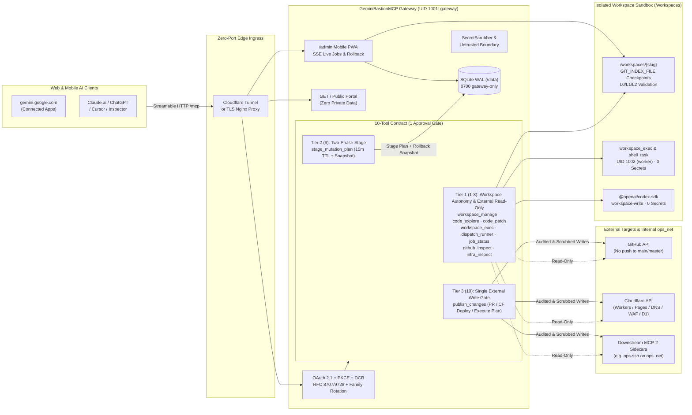

<div align="center">

# GeminiBastionMCP (`gemini-bastion-mcp`)

**English | [简体中文](README.zh-CN.md) | [Live Showcase Site](https://kaiserunix.github.io/gemini-bastion-mcp/) | [Product Strategy](docs/PRODUCT_STRATEGY.md) | [GitHub Repo](https://github.com/Kaiserunix/gemini-bastion-mcp)**

**Stop clicking "Allow" 40 times on your phone.**
**The self-hosted OAuth 2.1 MCP bastion that turns Web Gemini, Claude.ai & ChatGPT into a sandboxed full-stack coding, Codex & Cloudflare ops agent — with 10 tools funneled through 1 external approval gate (`publish_changes`).**

[](https://github.com/Kaiserunix/gemini-bastion-mcp/actions/workflows/ci.yml)
[](https://kaiserunix.github.io/gemini-bastion-mcp/)
[](https://modelcontextprotocol.io)
[](#connecting-ai-clients)
[](docker/Dockerfile)
[](docker/docker-compose.yml)
[](LICENSE)

</div>

---

- **Code from `gemini.google.com` on Mobile or Desktop**: Open Web Gemini, sync a GitHub repository, inspect AST/files with `ripgrep`, `ast-grep`, and `repomix`, apply multi-file atomic patches, and run L0/L1/L2 validation suites — without touching a laptop.
- **Delegate Heavy Work to Background Codex & Shell Jobs**: Dispatch `@openai/codex-sdk` autonomous threads or long builds (`workspace_exec` auto-promotes to background SQLite jobs after 15s). Close the browser tab and receive a scrubbed Webhook alert when it finishes.
- **Zero Secret Leakage & 1-Gate Blast Radius**: Sandboxed shell and Codex subprocesses run with a strict env allowlist (`buildSandboxedEnv()`) that strips `GH_TOKEN`, `CLOUDFLARE_*`, and gateway secrets. Non-destructive `GIT_INDEX_FILE` checkpoints protect your working tree, direct pushes to `main`/`master` are blocked, and every external side effect is funneled through **one single approval gate (`publish_changes`)**.

> **Built for Web Gemini Connected Apps, Claude.ai, ChatGPT Connectors, Cursor & MCP Inspector.**

---

## What a 60-Second Mobile Prompt-to-PR Looks Like

> **You (on phone in Web Gemini):** *"Check why CI failed on PR #42, fix the bug, run tests, and open a fix PR."*
>
> 1. `github_inspect` *(Tier 1 · Always Allow)* — Fetches failed Actions logs wrapped in an untrusted-data boundary.
> 2. `workspace_manage` + `code_explore` *(Tier 1 · Always Allow)* — Syncs repo to `/workspaces/{slug}` and locates the fault via `ripgrep` / `ast-grep`.
> 3. `code_patch` + `workspace_exec` *(Tier 1 · Always Allow)* — Creates an automatic `GIT_INDEX_FILE` checkpoint, applies the atomic patch, and runs the test suite as UID `1002` (`worker`) with zero gateway secrets.
> 4. `publish_changes` *(Tier 3 · **Ask Before Running — 1 prompt total**)* — Shows the scrubbed branch/PR summary. You tap **Allow once** → PR opens on a non-protected branch (`main`/`master` direct push blocked).

---

## Why This Exists

Most remote MCP setups force an unpleasant tradeoff: either expose dozens of granular tools (triggering endless approval popups on every file read or test run) or run an unguarded shell directly on your host.

| Capability | **GeminiBastionMCP** | Generic Aggregators (e.g. MetaMCP) | Official Remote MCPs (GitHub / CF) | Local Shell / Stdio MCP |
| :--- | :--- | :--- | :--- | :--- |
| **Web Gemini (`gemini.google.com`) Native OAuth** | **Full Support** (OAuth 2.1 + PKCE S256 + DCR up to 16 redirect URIs + 8KB `state` + RFC 8707/9728) | Often missing RFC 9728/8707 or large `state` support | Single-vendor hosted only | Desktop/local client only |
| **Web Chat Approval UX** | **10 Tools, 1 Approval Gate** (Tier 1/2 `Always Allow`, only `publish_changes` asks) | Dozens of fragmented tools = constant confirmation popups | Read & write tools mixed | Confirm every shell command or run wide open |
| **Sandboxed Test Runner + Async Codex** | **Built-in** (`workspace_exec` 15s auto-promotion + `@openai/codex-sdk` thread resume) | No execution sandbox | API-only; cannot run local builds/tests | Runs on host; no background job promotion |
| **Secret Isolation & Undo** | **UID 1002 Shell Isolation + Strict Env Allowlist + `SecretScrubber` + `GIT_INDEX_FILE` Snapshots** | Depends on downstream servers | Cloud-managed | Child processes inherit host env |
| **Two-Phase Infra Mutations** | **`stage_mutation_plan` (15m TTL + rollback snapshot) -> `publish_changes`** | Direct passthrough writes | Direct writes | None |

---

## Architecture Overview



---

## 10 Tools, 1 Approval Gate

Instead of exposing 40+ fine-grained tools that bury mobile/web users under approval prompts, `GeminiBastionMCP` groups every capability by **blast radius** so you can configure per-tool approvals cleanly in Web Gemini or Claude:

### Tier 1 — Workspace-Scoped Autonomy & External Read-Only *(Safe for `Always Allow`)*

> **Why `Always Allow` is safe here**: Tools 3–5 (`code_patch`, `workspace_exec`, `dispatch_runner`) edit files and run commands **strictly inside `/workspaces/{slug}`** — protected by zero-secret `buildSandboxedEnv()`, `SecretScrubber`, and automatic `GIT_INDEX_FILE` rollback checkpoints — while performing **zero external writes** to GitHub, Cloudflare, or production hosts.

| # | Tool | Scope & Behavior |
|---|------|------------------|
| 1 | `workspace_manage` | `list`, `sync_github`, `init_cf_ops`, `list_checkpoints`, `rollback` (auto-detects stack & `AGENTS.md` / `CLAUDE.md`) |
| 2 | `code_explore` | Read-only workspace inspection: `pack` (repomix), `search` (ripgrep), `ast` (ast-grep), `read_lines`, `read_artifact`, `git_diff` |
| 3 | `code_patch` | Local workspace mutation: atomic multi-file `patch` (`hunks` + `line_hint`), `create_or_overwrite`, `delete_file` with auto-checkpoint + L0/L1/L2 validation |
| 4 | `workspace_exec` | Sandboxed shell in `/workspaces/{slug}` executed as UID `1002` (`worker`) (`wait_ms` up to `15000`; auto-promotes long runs to background SQLite `job_id`) |
| 5 | `dispatch_runner` | Background `codex_readonly`, `codex_write` (`@openai/codex-sdk` `workspace-write` sandbox), or `shell_task` (UID `1002`) with thread resume, token/duration budgets, and auto-checkpoint |
| 6 | `job_status` | Poll job status, streamed events, token usage, `thread_id`, `git status -sb`, final report, or `cancel: true` |
| 7 | `github_inspect` | External read-only: PR diffs/files, issue threads, and failed Actions logs (wrapped with untrusted-data boundary markers) |
| 8 | `infra_inspect` | External read-only: Cloudflare inspection (`zones`, `dns_records`, `workers`, `pages`, `kv_namespaces`, `d1_databases`, `waf_rules`, `worker_tail_logs`) + downstream MCP-2 `readonlyTools` |

### Tier 2 — Zero-Side-Effect Change Staging *(Safe for `Always Allow`)*

| # | Tool | Actions & Behavior |
|---|------|--------------------|
| 9 | `stage_mutation_plan` | Captures pre-change live state to build a `rollback_payload` and human-readable diff, issuing a 15-minute `plan_id`. Supports **5 Cloudflare plan types** (`dns_record_create`, `dns_record_update`, `dns_record_delete`, `waf_rule_update`, `d1_sql_mutation`) plus downstream MCP-2 `mutatingTools`. **Performs zero writes.** |

### Tier 3 — Single External Write Gate *(Set to `Ask Before Running`)*

| # | Tool | Actions & Behavior |
|---|------|--------------------|
| 10 | `publish_changes` | **The ONLY external write exit**: `github_pr` (blocks direct push to `main`/`master`/default), `github_pr_review`, `github_comment`, `cloudflare_worker_deploy` (preview URL default), `cloudflare_pages_deploy`, `execute_staged_plan`, `rollback_plan`. |

---

## 3-Minute Quick Start

### Option A: Docker Compose + Cloudflare Tunnel (Recommended)

[`docker/docker-compose.yml`](docker/docker-compose.yml) runs `gateway` with **zero host ports exposed** (`expose: ["8787"]` only). All external HTTPS traffic enters through `cloudflared`.

1. **Create `.env` from the template**:
   ```bash
   cp .env.example .env
   ```

2. **Generate `ADMIN_PASSWORD_HASH` (`scrypt:`) and `OAUTH_SIGNING_SECRET` in one shot** (Node 22+):
   ```bash
   node -e 'const c=require("node:crypto"),s=c.randomBytes(16).toString("hex");console.log(`OAUTH_SIGNING_SECRET=${c.randomBytes(32).toString("hex")}\nADMIN_PASSWORD_HASH=scrypt:${s}:${c.scryptSync(process.argv[1],s,32,{N:16384,r:8,p:1}).toString("hex")}`)' 'your-admin-password'
   ```
   *(The `scrypt:<saltHex>:<keyHex>` format contains no `$` characters, avoiding Docker Compose `.env` interpolation issues; legacy `scrypt$...` and `sha256:` formats remain supported if `$` is escaped as `$$`.)*

3. **Fill required `.env` values**:
   - `PUBLIC_DOMAIN=https://mcp.yourdomain.com`
   - `TRUST_CF_CONNECTING_IP=true`
   - `OAUTH_SIGNING_SECRET=<generated above>`
   - `ADMIN_PASSWORD_HASH=<generated above>`
   - `CLOUDFLARE_TUNNEL_TOKEN=<your Cloudflare Zero Trust tunnel token>`
   - Optional client & integration settings: append `claude.ai,chatgpt.com` to `OAUTH_ALLOWED_REDIRECT_HOSTS` if connecting Claude/ChatGPT; add `GH_TOKEN`, `OPENAI_API_KEY` / `CODEX_API_KEY`, `CLOUDFLARE_ACCOUNT_ID`, `CLOUDFLARE_READONLY_API_TOKEN`, `CLOUDFLARE_API_TOKEN` as needed.

4. **Point your Cloudflare Tunnel Public Hostname** (Zero Trust → Networks → Tunnels) for `mcp.yourdomain.com` to `http://gateway:8787`.

5. **Build & launch with a single root `.env`** (pass `--env-file .env` so `cloudflared` reads `CLOUDFLARE_TUNNEL_TOKEN` from root `.env` without creating a separate `docker/.env`):
   ```bash
   docker compose --env-file .env -f docker/docker-compose.yml up -d --build
   ```
   > **Security isolation note**: `cloudflared` receives only `TUNNEL_TOKEN` (never mounts `../.env`), and `gateway` explicitly clears `CLOUDFLARE_TUNNEL_TOKEN` from its own environment. [`docker/Dockerfile`](docker/Dockerfile) enforces `Node >= 22.23.4` at build time (override with `NODE_IMAGE=node:22.23.4-bookworm-slim` if needed).

### Option B: Reverse Proxy with Nginx (Loopback Host Port)

If you already terminate TLS with Nginx on a VPS instead of Cloudflare Tunnel:

1. Bind `gateway` strictly to loopback (`127.0.0.1:8787:8787` or `127.0.0.1:39120:8787`) via a `docker-compose.override.yml`, set `TRUST_CF_CONNECTING_IP=false` in `.env` (unless fronted by Cloudflare), and run `gateway` without `cloudflared`:
   ```bash
   docker compose --env-file .env -f docker/docker-compose.yml up -d --build gateway
   ```
2. Proxy HTTPS traffic to the loopback port with buffering disabled for Streamable HTTP & `/admin` SSE:
   ```nginx
   location / {
     proxy_pass http://127.0.0.1:8787;
     proxy_http_version 1.1;
     proxy_set_header Host $host;
     proxy_set_header X-Real-IP $remote_addr;
     proxy_set_header X-Forwarded-For $proxy_add_x_forwarded_for;
     proxy_set_header X-Forwarded-Proto $scheme;
     proxy_buffering off;
     proxy_read_timeout 300s;
   }
   ```

### Option C: Local Development

**Prerequisites**: Node.js `>= 22.23.4`, `git`, and C++ build tools for `better-sqlite3`.

```bash
npm install
cp .env.example .env
# Set DATA_DIR=./.local/data, WORKSPACES_DIR=./.local/workspaces, OAUTH_SIGNING_SECRET, and ADMIN_PASSWORD_HASH
npm run typecheck
npm test
npm run dev
```

Verify at `http://127.0.0.1:8787/healthz` and `http://127.0.0.1:8787/`. Both `npm run dev` and `npm start` automatically load `.env` via Node's `--env-file-if-exists=.env`.

---

## Connecting AI Clients

`GeminiBastionMCP` implements **MCP 2025-11-25 Streamable HTTP** (stateless `/mcp`, no legacy HTTP+SSE) with **OAuth 2.1 + PKCE (`S256`) + RFC 8707 Resource Indicators + RFC 9728 Protected Resource Metadata**.

### Web Gemini (`gemini.google.com` Connected Apps)

1. Confirm `PUBLIC_DOMAIN` matches your public HTTPS URL and `OAUTH_ALLOWED_REDIRECT_HOSTS` includes `gemini.google.com,aistudio.google.com,accounts.google.com` (default in `.env.example`).
2. In Gemini Connected Apps / Custom MCP connector settings, enter:
   ```text
   https://mcp.yourdomain.com/mcp
   ```
3. Gemini automatically discovers `/.well-known/oauth-protected-resource`, `/.well-known/oauth-authorization-server`, and registers via `POST /oauth/register` (supports up to **16 redirect URIs** per client and `state` values up to **8192 bytes**).
4. Complete the browser OAuth consent prompt. Refresh tokens rotate with a 60-second grace window for concurrent retries.
5. **Recommended tool permissions**: Set Tools 1–9 (`workspace_manage` through `stage_mutation_plan`) to **Always Allow**, and keep Tool 10 (`publish_changes`) on **Ask Before Running**.

### Claude.ai, ChatGPT & MCP Inspector (DCR or Static Client Fallback)

> [!IMPORTANT]
> **Required for Claude.ai & ChatGPT OAuth DCR**: By default, `OAUTH_ALLOWED_REDIRECT_HOSTS` in `.env.example` only allowlists Google/Gemini and localhost hosts (`gemini.google.com,aistudio.google.com,accounts.google.com,localhost,127.0.0.1`). Before connecting Claude.ai or ChatGPT, append their callback hosts in `.env` and restart `gateway`:
> ```env
> OAUTH_ALLOWED_REDIRECT_HOSTS=gemini.google.com,aistudio.google.com,accounts.google.com,claude.ai,chatgpt.com,localhost,127.0.0.1
> ```

- **Automatic DCR**: Point Claude.ai Custom Connectors, ChatGPT, or MCP Inspector directly to `https://mcp.yourdomain.com/mcp`.
- **Static Client Fallback**: If a client requires pre-configured credentials, set `OAUTH_STATIC_CLIENT_ID` and `OAUTH_STATIC_CLIENT_SECRET` in `.env`, restart `gateway`, and configure:
  - **MCP URL**: `https://mcp.yourdomain.com/mcp`
  - **Authorization URL**: `https://mcp.yourdomain.com/oauth/authorize`
  - **Token URL**: `https://mcp.yourdomain.com/oauth/token`

---

## Upstream Operator Login (Google & GitHub OAuth)

In addition to `ADMIN_PASSWORD_HASH`, you can enable **Google OAuth** and/or **GitHub OAuth** for one-tap operator sign-in on `/admin/login` and MCP consent approval on `/oauth/authorize`:

### 1. Register Callback URLs

- **Google Cloud Console** (OAuth 2.0 Web Application → Authorized redirect URIs):
  ```text
  https://<PUBLIC_DOMAIN>/auth/idp/google/callback
  ```
- **GitHub Developer Settings** (OAuth App → Authorization callback URL):
  ```text
  https://<PUBLIC_DOMAIN>/auth/idp/github/callback
  ```

### 2. Configure Environment Variables (`.env`)

- **Google OAuth**:
  - `GOOGLE_OAUTH_CLIENT_ID`
  - `GOOGLE_OAUTH_CLIENT_SECRET`
  - `GOOGLE_OAUTH_ALLOWED_EMAILS` (comma-separated allowlisted operator email(s))
- **GitHub OAuth**:
  - `GITHUB_OAUTH_CLIENT_ID`
  - `GITHUB_OAUTH_CLIENT_SECRET`
  - `GITHUB_OAUTH_ALLOWED_USERS` (comma-separated allowlisted GitHub username(s))
  - `GITHUB_OAUTH_ALLOWED_IDS` *(optional; if both `GITHUB_OAUTH_ALLOWED_USERS` and `GITHUB_OAUTH_ALLOWED_IDS` are set, both must match)*

> **Fail-Closed Security Model**: Both IdPs stay disabled unless credentials **and** a non-empty allowlist are configured — and in `NODE_ENV=production`, providing client credentials without an allowlist fails startup closed. Google requires `email_verified: true`, and all upstream OAuth flows are protected by PKCE `S256`, `HttpOnly` state-binding cookies, and CSRF validation.

---

## Public Gateway Portal (`GET /`) & `/admin` Mobile PWA

- **Public Gateway Portal (`GET /`)**: Returns a clean dark-mode status page with one-click `/mcp` endpoint copy, `.well-known` discovery links, quick-connect instructions, and a link to `/admin` — **without querying or exposing any private workspaces, jobs, tokens, or secrets**. Clients requesting `Accept: application/json` receive structured JSON status metadata.
- **Operator Command Cockpit (`/admin`)**: Sign in with the password matching `ADMIN_PASSWORD_HASH` (or configured Google/GitHub OAuth). The mobile-installable PWA provides a top 4-KPI Pulse Strip (`Active Jobs`, `Staged Plans`, `Workspaces`, `OAuth Sessions`), one-click `/mcp` URL copy, live SSE job logs with `[Expand / Collapse]`, confirmation prompts on destructive actions (`Kill`, `Rollback`, `Revoke`, `Delete Client`), and scrubbed `audit_logs`.

---

## 6-Layer Security & Guardrails

1. **Zero Secret Leakage**: `workspace_exec`, `shell_task`, and Codex runners use `buildSandboxedEnv()` (strict allowlist stripping `GH_TOKEN`, `CLOUDFLARE_*`, `OAUTH_SIGNING_SECRET`, `ADMIN_PASSWORD_HASH`, `NOTIFY_WEBHOOK_URL`, and `DOWNSTREAM_MCPS_*`). All outputs, artifacts, and webhooks pass through `SecretScrubber`.
2. **Linux UID 1001 / 1002 Isolation**: In Docker, `gateway` (UID `1001`) owns `/data` (`0700`, SQLite DB, `/data/artifacts`, and `CODEX_HOME=/data/codex`) and `/app`, while `worker` (UID `1002`) owns `/workspaces` and `/opt/mise` with zero access to `/data` (and `/opt/mise/shims` is excluded from `gateway`'s `PATH`). `workspace_exec` and `shell_task` drop privileges to UID `1002` (`sudo -n -H -u #1002`); Codex tasks run under `@openai/codex-sdk`'s `workspace-write` sandbox + strict env allowlist *(extending UID `1002` isolation to `code_patch` L1/L2 validation subprocesses is tracked as P0 in [docs/PRODUCT_STRATEGY.md](docs/PRODUCT_STRATEGY.md))*.
3. **Non-Destructive Git Checkpoints**: Pre-patch and pre-Codex snapshots use a temporary `GIT_INDEX_FILE` (`refs/mcp-checkpoints/*`) without mutating your working tree index or `HEAD`.
4. **Protected Branch & Diff Guard**: `publish_changes` (`github_pr`) blocks direct pushes to `main`, `master`, or the repo's default branch, and blocks committing sensitive files (`.env*`, `*.pem`, `*.key`, `id_rsa*`, `.dev.vars*`).
5. **Untrusted Data Boundary**: External GitHub issues/PRs/logs, Cloudflare tail logs, and downstream MCP-2 responses are wrapped as untrusted external content to defend against prompt injection.
6. **OAuth 2.1 Family Rotation & Replay Protection**: Refresh token reuse outside the 60-second grace window revokes the entire token family immediately.

---

## Optional `ops-mcp` Sidecar Federation (MCP-2)

Federate internal HTTP or local `stdio` MCP servers (such as `uarlouski/ssh-mcp-server` bridged via `mcp-proxy` on isolated `ops_net`) without exposing SSH keys to `/workspaces`:

1. Create `docker/ops-ssh/` containing your restricted `config.json` and scoped SSH key(s).
2. Copy [`docker/ops-mcp-config.example.json`](docker/ops-mcp-config.example.json) to `docker/ops-mcp-config.json` and review `readonlyTools`, `mutatingTools`, and `deniedTools`.
3. Uncomment `./ops-mcp-config.json:/etc/gemini-bastion/ops-mcp-config.json:ro` in [`docker/docker-compose.yml`](docker/docker-compose.yml) and set `DOWNSTREAM_MCPS_FILE=/etc/gemini-bastion/ops-mcp-config.json` in `.env`.
4. Build and start with the `ops` profile (uses [`docker/Dockerfile.ops-mcp`](docker/Dockerfile.ops-mcp) with pre-installed binaries so `ops-mcp` runs offline on `internal: true` `ops_net` as non-root `node`):
   ```bash
   docker compose --env-file .env -f docker/docker-compose.yml --profile ops up -d --build
   ```

**Policy enforcement**: `readonlyTools` run in `infra_inspect`; `mutatingTools` must be staged via `stage_mutation_plan` and executed via `publish_changes`; `deniedTools` and unlisted tools are strictly rejected.

---

## Webhook Notifications & Docs

- **Webhooks**: Set `NOTIFY_WEBHOOK_URL` in `.env` to receive `SecretScrubber`-sanitized JSON POST webhooks whenever background jobs finish/fail/cancel or when staged mutation plans execute or roll back.
- **Further Reading**: [Architecture & Design (`DESIGN.md`)](DESIGN.md) · [Product Strategy & Security Roadmap (`docs/PRODUCT_STRATEGY.md`)](docs/PRODUCT_STRATEGY.md)
