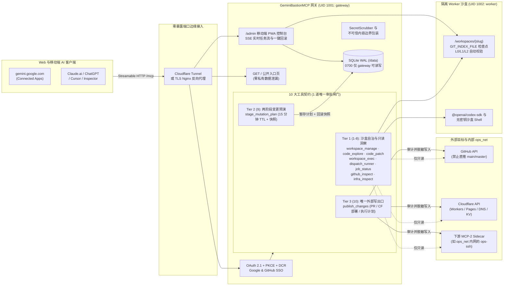

<p align="center">
  
</p>

<div align="center">

# GeminiBastionMCP (`gemini-bastion-mcp`)

**专为 Web Gemini Connected Apps、Claude.ai Custom Connectors 与 ChatGPT MCP 打造的开源自托管 OAuth 2.1 Remote MCP Server 研发运维堡垒网关：内置沙盒工作区、OpenAI Codex SDK 异步引擎与 Cloudflare Workers/Pages 管控，以「10 大复合工具 + 1 道唯一出闸门」彻底终结授权弹窗地狱与密钥泄漏。**

[](https://github.com/Kaiserunix/gemini-bastion-mcp/actions/workflows/ci.yml)
[](https://kaiserunix.github.io/gemini-bastion-mcp/)
[](CHANGELOG.md)
[](docker/Dockerfile)
[](https://modelcontextprotocol.io)
[](#连接-ai-客户端)
[](.github/workflows/ci.yml)
[](LICENSE)

**[English](README.md) | 简体中文**

[项目主页 (Live Showcase)](https://kaiserunix.github.io/gemini-bastion-mcp/) · [为什么做这个项目](#为什么做这个项目why-this-exists) · [整体架构](#整体架构图) · [10 大工具](#10-大工具1-道审批闸门) · [界面预览](#界面预览) · [3 分钟上手](#3-分钟快速上手) · [Google/GitHub SSO](#上游管理员-oauth-登录google--github-oauth) · [安全防线](#六层安全防线与护栏)

</div>

---

- **在手机或浏览器用 `gemini.google.com` Connected Apps 写代码、跑测试**：打开网页版 Gemini，一键同步 GitHub 仓库，用 `ripgrep`、`ast-grep` 和 `repomix` 探索代码，打多文件原子补丁并跑通 L0/L1/L2 校验流水线——无需守在电脑前。
- **把重任务委托给后台 OpenAI Codex SDK 与长耗时构建**：一条指令派发 `@openai/codex-sdk` 异步线程或测试构建（`workspace_exec` 超过 15 秒自动晋升为后台 SQLite Job）。关掉网页照样跑，完成后通过 Webhook 推送脱敏通知到手机。
- **零密钥泄漏 & 单闸门爆炸半径控制**：沙盒内子进程彻底剥离 `GH_TOKEN`、`CLOUDFLARE_*` 等网关密钥；`GIT_INDEX_FILE` 非破坏性快照保护工作树，物理拦截直推 `main`/`master`，一切外部写入操作强制收束于**唯一出闸门 (`publish_changes`)**。

> [!TIP]
> **原生适配 Web Gemini Connected Apps、`claude.ai` Custom Connectors、ChatGPT MCP、Cursor 与 MCP Inspector** —— 基于无状态 **MCP 2025-11-25 Streamable HTTP** 与 **OAuth 2.1 + PKCE + Dynamic Client Registration (DCR)**。

---

## 为什么做这个项目（Why This Exists）

大多数远程 MCP Server 都面临两难：要么暴露三四十个零碎工具，导致网页端每读一个文件、跑一次测试就弹一次授权确认框；要么直接在宿主机裸跑 Shell，毫无密钥隔离与回滚保护。

| 能力维度 | **GeminiBastionMCP** | 通用聚合网关 (如 MetaMCP) | 官方远程 MCP (GitHub / CF) | 本地 Shell / Stdio MCP |
| :--- | :--- | :--- | :--- | :--- |
| **Web Gemini (`gemini.google.com`) OAuth 2.1 DCR** | **完整支持** (PKCE `S256`、DCR 支持 16 个 Redirect URIs、8KB `state`、RFC 8707/9728) | 多数缺少 RFC 9728/8707 或大 `state` 支持 | 仅限单一官方平台 | 仅限本地桌面客户端 |
| **Web 与移动端授权弹窗体验** | **10 工具收敛 + 唯一审批闸门** (Tier 1/2 可设始终允许，仅 `publish_changes` 需确认) | 几十个底层工具导致确认弹窗点到手软 | 读写工具混杂 | 每次执行命令均需确认或全裸奔 |
| **真沙盒跑测试 + OpenAI Codex SDK** | **原生内置** (`workspace_exec` 15s 自动转后台 Job + `@openai/codex-sdk` 线程续接) | 无代码执行沙盒 | 仅 API 调用，不能跑本地构建/测试 | 跑在宿主机，无后台 Job 晋升机制 |
| **密钥隔离与无损回滚** | **双 UID (1001/1002) + 环境白名单 + `SecretScrubber` + `GIT_INDEX_FILE` 快照** | 取决于下游服务 | 云端托管 | 子进程直接继承宿主机全量环境变量 |
| **两阶段基础设施变更 (Plan -> Apply)** | **`stage_mutation_plan` (15 分钟 TTL + 回滚快照) -> `publish_changes`** | 直接透传写操作 | 直接执行写操作 | 无 |

---

## 整体架构图



---

## 10 大工具，1 道审批闸门

与其暴露 40 多个细粒度工具让用户在手机/网页上被弹窗淹没，`GeminiBastionMCP` 按**影响半径 (Blast Radius)** 将全部能力收敛为 3 档：

### Tier 1 — 沙盒内自治与只读洞察 *（客户端建议设为 `Always Allow` 始终允许）*

| # | 工具名 | 核心动作与行为 |
|---|--------|----------------|
| 1 | `workspace_manage` | `list`、`sync_github`、`init_cf_ops`、`list_checkpoints`、`rollback`（自动识别技术栈与 `AGENTS.md` / `CLAUDE.md`） |
| 2 | `code_explore` | `pack` (repomix)、`search` (ripgrep)、`ast` (ast-grep)、`read_lines`、`read_artifact`、`git_diff` |
| 3 | `code_patch` | 原子化多文件 `patch`（支持 `hunks` + `line_hint`）、`create_or_overwrite`、`delete_file`，自带自动检查点与 L0/L1/L2 校验回滚 |
| 4 | `workspace_exec` | 在 `/workspaces/{slug}` 内运行沙盒命令（`wait_ms` 最长 `15000`；超时自动转后台 SQLite `job_id`） |
| 5 | `dispatch_runner` | 基于 `@openai/codex-sdk` 派发后台 `codex_readonly`、`codex_write` 或 `shell_task`，支持线程续接、预算上限及自动检查点 |
| 6 | `job_status` | 查询任务状态、流式事件、Token 消耗、`thread_id`、`git status -sb`、最终报告，或通过 `cancel: true` 实时中止 |
| 7 | `github_inspect` | 只读查看 PR Diff/文件、Issue 评论与失败的 Actions 日志（带防 Prompt 注入的不可信数据边界包装） |
| 8 | `infra_inspect` | 只读巡检 Cloudflare（`zones`、`dns_records`、`workers`、`pages`、`kv_namespaces`、`d1_databases`、`waf_rules`、`worker_tail_logs`）及下游 MCP-2 `readonlyTools` |

### Tier 2 — 零副作用变更预演 *（客户端建议设为 `Always Allow`）*

| # | 工具名 | 核心动作与行为 |
|---|--------|----------------|
| 9 | `stage_mutation_plan` | 抓取变更前线上快照生成 `rollback_payload` 与人类可读 Diff，签发 15 分钟有效期的 `plan_id`（适用于 Cloudflare 变更或下游 MCP-2 `mutatingTools`）。**不执行任何真实写入。** |

### Tier 3 — 唯一外部写出口 *（客户端设为 `Ask Before Running` 每次询问）*

| # | 工具名 | 核心动作与行为 |
|---|--------|----------------|
| 10 | `publish_changes` | **全网关唯一的外部写入总闸门**：`github_pr`（物理拦截直推 `main`/`master`/默认分支）、`github_pr_review`、`github_comment`、`cloudflare_worker_deploy`（默认预览 URL）、`cloudflare_pages_deploy`、`execute_staged_plan`、`rollback_plan`。 |

---

## 界面预览

<table>
  <tr>
    <td width="50%" align="center">
      
      <br />
      <sub><strong>公开网关门户 (<code>GET /</code>)</strong> — 零私有数据泄漏状态页，支持一键复制 <code>/mcp</code>、<code>.well-known</code> 链接与 JSON 内容协商。</sub>
    </td>
    <td width="50%" align="center">
      
      <br />
      <sub><strong>移动端运维座舱 (<code>/admin</code> PWA)</strong> — 4 宫格 KPI 态势条、SSE 实时日志流、<code>Kill</code> / <code>Rollback</code> 二次确认与脱敏审计日志。</sub>
    </td>
  </tr>
</table>

---

## 3 分钟快速上手

### 方式 A：Docker Compose + Cloudflare Tunnel（推荐）

[`docker/docker-compose.yml`](docker/docker-compose.yml) 启动的 `gateway` 容器**不向宿主机暴露任何公网端口**（仅内部 `expose: ["8787"]`），全部外部 HTTPS 流量由 `cloudflared` 隧道安全引入。

1. **克隆仓库并初始化 `.env`**：
   ```bash
   git clone https://github.com/Kaiserunix/gemini-bastion-mcp.git
   cd gemini-bastion-mcp
   cp .env.example .env
   ```

2. **生成 `ADMIN_PASSWORD_HASH`（`scrypt:`）与 `OAUTH_SIGNING_SECRET`**：
   生产环境推荐无 `$` 符号、可安全用于 Docker Compose 的 `scrypt:<saltHex>:<keyHex>` 与 `sha256:<hex>` 格式（同时兼容 `scrypt$<saltHex>$<keyHex>` 与 `sha256$<hex>`；若在 Docker Compose `.env` 中使用 `$` 格式需转义为 `$$`）：
   ```bash
   node -e 'const c=require("node:crypto"),s=c.randomBytes(16).toString("hex");console.log(`scrypt:${s}:${c.scryptSync(process.argv[1],s,32,{N:16384,r:8,p:1}).toString("hex")}`)' 'your-admin-password'
   ```
   ```bash
   node -e 'console.log(require("node:crypto").randomBytes(32).toString("hex"))'
   ```

3. **填写 `.env` 关键配置**，在 Cloudflare Zero Trust 控制台将 Public Hostname（如 `mcp.yourdomain.com`）指向 `http://gateway:8787`，并将 `CLOUDFLARE_TUNNEL_TOKEN=<token>` 写入 `docker/.env`（或在 Shell 中 export）：
   ```bash
   docker compose -f docker/docker-compose.yml up -d --build
   ```

> [!IMPORTANT]
> **Node 22 安全基线**：[`docker/Dockerfile`](docker/Dockerfile) 在构建期强制校验 `Node >= 22.23.4`。可在 `docker/.env` 中固定 `NODE_IMAGE=node:22.23.4-bookworm-slim` 或传递 `--build-arg`。注意 `cloudflared` 仅接收 `TUNNEL_TOKEN`（不会挂载 `../.env`）。

<details>
<summary><strong>环境变量参考 (.env)</strong></summary>

| 变量名 | 说明 |
| :--- | :--- |
| `PUBLIC_DOMAIN` | 网关公网 HTTPS Origin（例如 `https://mcp.yourdomain.com`） |
| `TRUST_CF_CONNECTING_IP` | Cloudflare Tunnel/CDN 后设为 `true`；直连 Nginx 时设为 `false` |
| `OAUTH_SIGNING_SECRET` | `>= 32` 字节随机 hex/base64 密钥（`NODE_ENV=production` 拒绝占位符） |
| `ADMIN_PASSWORD_HASH` | `scrypt:<saltHex>:<keyHex>`（推荐）或 `sha256:<hex>` |
| `OAUTH_STATIC_CLIENT_ID` / `_SECRET` | 可选静态 OAuth 客户端凭据（供不支持 DCR 的客户端兜底） |
| `GOOGLE_OAUTH_*` / `GITHUB_OAUTH_*` | 可选 Fail-Closed 上游管理员 SSO 凭据与白名单 |
| `GH_TOKEN` | GitHub PAT（仅限网关进程；严禁暴露给 `workspace_exec` 或 Codex） |
| `CLOUDFLARE_ACCOUNT_ID` / `_READONLY_API_TOKEN` / `_API_TOKEN` | Cloudflare 账号与只读/写入分离 Token |
| `OPENAI_API_KEY` / `CODEX_API_KEY` | OpenAI / Codex SDK 执行引擎凭据（`CODEX_DEFAULT_MODEL`、`CODEX_TOKEN_BUDGET`） |
| `NOTIFY_WEBHOOK_URL` | 可选 Webhook 通知 URL（推送经脱敏的任务与变更状态） |
| `DOWNSTREAM_MCPS_FILE` / `_JSON` | 可选下游 MCP-2 联邦配置 |

</details>

### 方式 B：Nginx 反向代理部署（本机回环端口）

通过 `docker-compose.override.yml` 将 `gateway` 仅绑定到宿主机回环地址（如 `127.0.0.1:8787:8787` 或 `127.0.0.1:39120:8787`），在 `.env` 设 `TRUST_CF_CONNECTING_IP=false`，并仅启动 `gateway` 服务：

```bash
docker compose -f docker/docker-compose.yml up -d --build gateway
```

<details>
<summary><strong>Nginx 反向代理配置示例（支持 Streamable HTTP、SSE 与 8KB OAuth State）</strong></summary>

```nginx
server {
  listen 443 ssl http2;
  server_name mcp.yourdomain.com;

  # 必须调大请求头缓冲，确保 Gemini 的 2400-8192 字节 OAuth state 不会触发 414 Request-URI Too Large
  large_client_header_buffers 4 16k;
  client_max_body_size 1m;

  location / {
    proxy_pass http://127.0.0.1:8787;
    proxy_http_version 1.1;
    proxy_set_header Connection "";
    proxy_set_header Host $host;
    proxy_set_header X-Real-IP $remote_addr;
    proxy_set_header X-Forwarded-For $proxy_add_x_forwarded_for;
    proxy_set_header X-Forwarded-Proto $scheme;
    proxy_buffering off;
    proxy_request_buffering off;
    proxy_read_timeout 300s;
  }
}
```

</details>

### 方式 C：本地开发模式

```bash
npm install
cp .env.example .env
# 在 .env 中设置 DATA_DIR=./.local/data、WORKSPACES_DIR=./.local/workspaces、OAUTH_SIGNING_SECRET 与 ADMIN_PASSWORD_HASH
npm run typecheck
npm test
npm run dev
```

访问 `http://127.0.0.1:8787/healthz` 与 `http://127.0.0.1:8787/` 验证服务在线。`npm run dev` 与 `npm start` 均通过 Node 原生 `--env-file-if-exists=.env` 自动加载 `.env`。

---

## 连接 AI 客户端

`GeminiBastionMCP` 遵循 **MCP 2025-11-25 Streamable HTTP** 规范（无状态 `/mcp`，彻底摒弃旧版 HTTP+SSE），支持 **OAuth 2.1 + PKCE (`S256`) + RFC 8707 Resource Indicators + RFC 9728 Protected Resource Metadata**。

- **Web Gemini（`gemini.google.com` Connected Apps）**：
  1. 确认 `PUBLIC_DOMAIN` 与公网 HTTPS 域名一致，且 `OAUTH_ALLOWED_REDIRECT_HOSTS` 包含 `gemini.google.com,aistudio.google.com,accounts.google.com`（`.env.example` 已默认配置）。
  2. 在 Gemini Connected Apps / 自定义 MCP 连接器中填写 `https://mcp.yourdomain.com/mcp`。
  3. Gemini 自动发现 `/.well-known/oauth-protected-resource` 与 `/.well-known/oauth-authorization-server`，并通过 `POST /oauth/register` 完成动态客户端注册（支持单客户端最多 **16 个 Redirect URIs** 与高达 **8192 字节** `state`）。
- **Claude.ai Custom Connectors、ChatGPT MCP 与 MCP Inspector**：
  - **自动 DCR**：直接填写 `https://mcp.yourdomain.com/mcp`。
  - **静态客户端兜底**：在 `.env` 配置 `OAUTH_STATIC_CLIENT_ID` 与 `OAUTH_STATIC_CLIENT_SECRET` 并重启 `gateway`，授权端点为 `/oauth/authorize`，令牌端点为 `/oauth/token`。

---

## 上游管理员 OAuth 登录（Google & GitHub OAuth）

除 `ADMIN_PASSWORD_HASH` 密码登录外，还可以开启 **Google OAuth** 与/或 **GitHub OAuth**，在 `/admin/login` 与 `/oauth/authorize`（MCP 授权确认页）一键完成管理员身份验证：

1. **注册回调地址（Callback URLs）**：
   - **Google Cloud Console**（OAuth 2.0 Web Application）：`https://<PUBLIC_DOMAIN>/auth/idp/google/callback`
   - **GitHub Developer Settings**（OAuth App）：`https://<PUBLIC_DOMAIN>/auth/idp/github/callback`
2. **在 `.env` 中配置凭据与管理员白名单**：
   - **Google OAuth**：`GOOGLE_OAUTH_CLIENT_ID`、`GOOGLE_OAUTH_CLIENT_SECRET`、`GOOGLE_OAUTH_ALLOWED_EMAILS`
   - **GitHub OAuth**：`GITHUB_OAUTH_CLIENT_ID`、`GITHUB_OAUTH_CLIENT_SECRET`、`GITHUB_OAUTH_ALLOWED_USERS`、可选 `GITHUB_OAUTH_ALLOWED_IDS` *（若同时配置用户与 ID，则必须同时匹配）*

> [!IMPORTANT]
> **Fail-Closed 安全模型**：只有同时配置凭据与非空管理员白名单时 IdP 才会启用；在 `NODE_ENV=production` 下，若只填凭据而未配置白名单将直接拒绝启动（Fail-Closed）。Google 登录强制校验 `email_verified: true`，所有上游登录流程均受 PKCE `S256`、`HttpOnly` 绑定 Cookie 与 CSRF 防护保护。

---

## 六层安全防线与护栏

1. **零网关密钥泄漏**：`workspace_exec`、`shell_task` 与 Codex Runner 均通过 `buildSandboxedEnv()` 构建严格环境变量白名单（剥离 `GH_TOKEN`、`CLOUDFLARE_*`、`OAUTH_SIGNING_SECRET`、`ADMIN_PASSWORD_HASH`、`NOTIFY_WEBHOOK_URL` 与 `DOWNSTREAM_MCPS_*`），全部输出、产物与 Webhook 载荷均经 `SecretScrubber` 脱敏。
2. **Linux UID 1001 / 1002 物理隔离**：Docker 容器内 `gateway`（UID `1001`）独占 `/data`（权限 `0700`，存放 SQLite 数据库、`/data/artifacts` 以及 `CODEX_HOME=/data/codex`）及 `/app`，而 `worker`（UID `1002`）拥有 `/workspaces` 与 `/opt/mise`，对 `/data` 零访问权限（且 `gateway` 的 `PATH` 不包含 `/opt/mise/shims`）。
3. **非破坏性 Git 快照**：每次 `code_patch` 与 Codex 写入前均使用临时 `GIT_INDEX_FILE` 创建 `refs/mcp-checkpoints/*` 快照，不污染当前暂存区与 `HEAD`。
4. **受保护分支与敏感文件拦截**：`publish_changes` (`github_pr`) 物理禁止向 `main`、`master` 或仓库默认分支直接推送，并阻止提交 `.env*`、`*.pem`、`*.key`、`id_rsa*`、`.dev.vars*` 等敏感文件。
5. **不可信内容边界防御**：GitHub Issue/PR/Actions 日志、Cloudflare 尾部日志与下游 MCP-2 返回均会封装为不可信外部数据边界，抵御间接 Prompt 注入。
6. **OAuth 2.1 Token 家族防重放熔断**：Refresh Token 超过 60 秒宽限期被重复使用时，立即吊销整条 Token Family。

---

## 可选 `ops-mcp` 运维 Sidecar 联邦（MCP-2）与 Webhook

在完全不向 `/workspaces` 暴露 SSH 私钥的前提下，通过内部隔离网络 `ops_net` 联邦调用下游 HTTP 或本地 `stdio` MCP 服务（例如经 `mcp-proxy` 桥接的 `uarlouski/ssh-mcp-server`）：

- 在 `.env` 中设置 `NOTIFY_WEBHOOK_URL`，即可在后台任务完成/失败/取消或变更计划执行/回滚时接收脱敏 JSON POST 通知。
- 使用 `ops` profile 启动（`docker compose -f docker/docker-compose.yml --profile ops up -d --build`），搭配 [`docker/Dockerfile.ops-mcp`](docker/Dockerfile.ops-mcp) 与 [`docker/ops-mcp-config.example.json`](docker/ops-mcp-config.example.json)：
  - `readonlyTools` 可在 `infra_inspect` 中直接调用
  - `mutatingTools` 必须经 `stage_mutation_plan` 暂存后再由 `publish_changes` 审批执行
  - `deniedTools` 及未登记工具一律拒绝

<details>
<summary><strong>DOWNSTREAM_MCPS_FILE 配置示例 (docker/ops-mcp-config.example.json)</strong></summary>

1. 创建 `docker/ops-ssh/` 目录并放入受限的 `config.json` 与最小权限 SSH 密钥。
2. 复制 `docker/ops-mcp-config.example.json` 为 `docker/ops-mcp-config.json`。
3. 在 `docker/docker-compose.yml` 中取消 `./ops-mcp-config.json:/etc/gemini-bastion/ops-mcp-config.json:ro` 挂载注释，并在 `.env` 设置 `DOWNSTREAM_MCPS_FILE=/etc/gemini-bastion/ops-mcp-config.json`。

```json
[
  {
    "id": "ops-ssh",
    "transport": "http",
    "url": "http://ops-mcp:8090/mcp",
    "enabled": true,
    "timeoutMs": 30000,
    "readonlyTools": ["list_hosts", "read_file", "list_directory", "get_host_status"],
    "mutatingTools": ["exec_command", "write_file", "upload_file"],
    "deniedTools": ["delete_file", "remove_directory", "create_tunnel", "raw_sudo_shell"]
  }
]
```

</details>

---

## 路线图、贡献与安全规范

- **路线图**：每任务独立容器 / microVM 隔离沙盒（`v0.2`）、`@openai/codex-sdk` 独立 Sidecar 进程以及多管理员 RBAC 策略。
- **参与贡献**：请参阅 [CONTRIBUTING.md](CONTRIBUTING.md) 了解开发环境配置、架构红线与 PR 检查清单。
- **安全政策**：请参阅 [SECURITY.md](SECURITY.md) 了解安全模型与漏洞私密上报方式。
- **版本记录与开源协议**：[CHANGELOG.md](CHANGELOG.md) · [MIT License](LICENSE)
