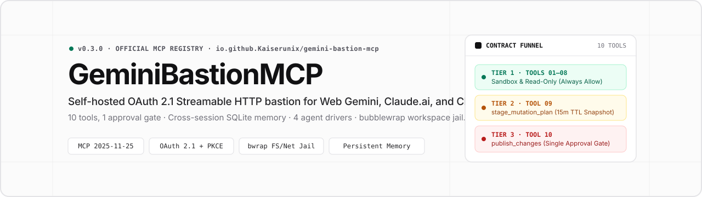
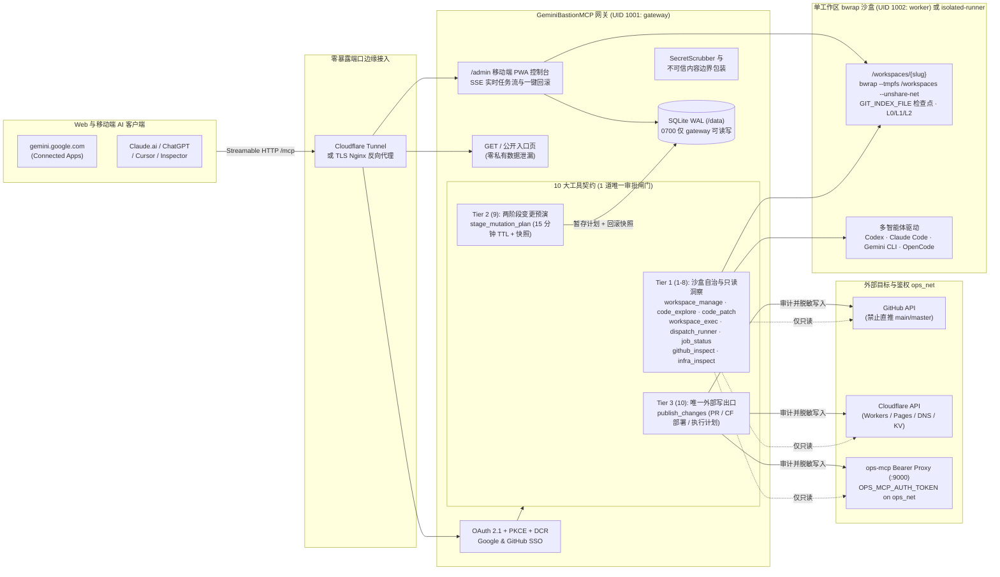
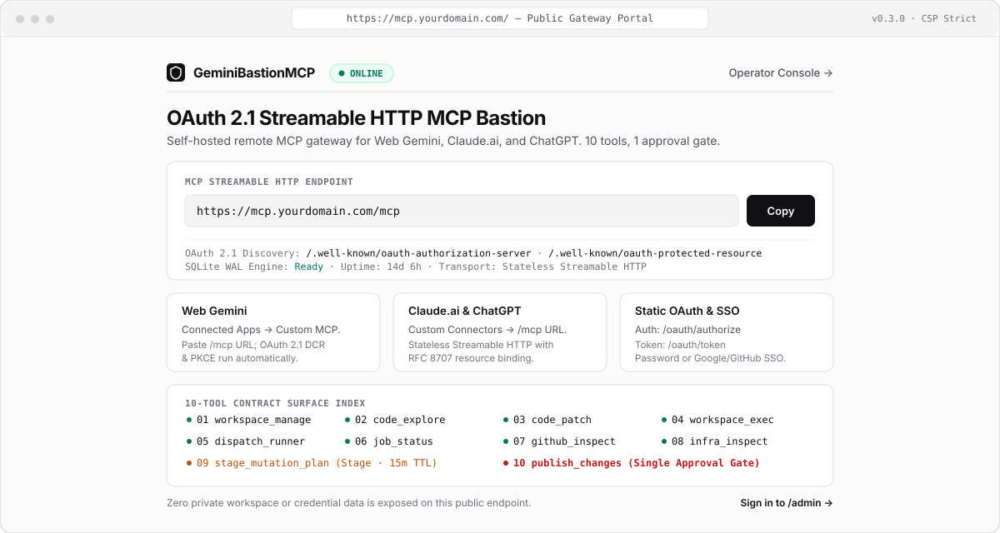
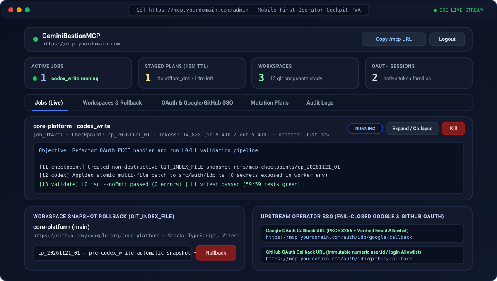

<p align="center">
  
</p>

<div align="center">

# GeminiBastionMCP (`gemini-bastion-mcp`)

**原生适配 Web Gemini (`gemini.google.com`) Connected Apps、Claude.ai Custom Connectors 与 ChatGPT MCP Connectors —— 绝非 Gemini 专属！**

[](https://github.com/Kaiserunix/gemini-bastion-mcp/actions/workflows/ci.yml)
[](https://github.com/Kaiserunix/gemini-bastion-mcp/actions/workflows/docker-publish.yml)
[](https://kaiserunix.github.io/gemini-bastion-mcp/)
[](CHANGELOG.md)
[%20%7C%20full-0ea5e9?style=flat-square)](https://github.com/Kaiserunix/gemini-bastion-mcp/pkgs/container/gemini-bastion-mcp)
[](server.json)
[](docker/Dockerfile)
[](https://modelcontextprotocol.io)
[](#连接-ai-客户端)
[](LICENSE)

**[English](README.md) | 简体中文**

[项目主页 (Live Showcase)](https://kaiserunix.github.io/gemini-bastion-mcp/) · [为什么做这个项目](#为什么做这个项目why-this-exists) · [整体架构](#整体架构图) · [10 大工具](#10-大工具1-道审批闸门) · [多引擎驱动](#可插拔多智能体驱动multi-agent-drivers) · [1 分钟上手](#1-分钟快速上手ghcr-零编译拉取) · [安全防线 v2](#安全架构-v2六层纵深防御) · [MCP Registry](#官方-mcp-registry-与-ghcr-镜像)

</div>

---

- **兼容 Web Gemini、Claude.ai 与 ChatGPT 的标准 Remote MCP Server**：之所以叫 `GeminiBastionMCP`，是因为它率先攻克了 `gemini.google.com` Connected Apps 最苛刻的 OAuth 2.1 DCR 规则（16 个 Redirect URIs、8KB `state`、RFC 8707/9728），同时底层 100% 遵循标准 **MCP 2025-11-25 Streamable HTTP**，无缝接入 **Claude.ai Custom Connectors、ChatGPT MCP、Cursor 与 MCP Inspector**。
- **在手机或任意浏览器里写代码、跑测试、发部署**：一键同步 GitHub 仓库，用 `ripgrep` / `ast-grep` / `repomix` 检索代码，打原子多文件补丁，并在 **单工作区 `bwrap` 文件系统与断网沙盒（默认 `--unshare-net`）** 中跑通 L0/L1/L2 校验。
- **可插拔多智能体驱动 + 单闸门爆炸半径控制**：后台任务支持 **OpenAI Codex SDK**、**Claude Code CLI**、**Gemini CLI** 与 **OpenCode CLI**（`workspace_exec` 超 15 秒自动转后台 Job），**零网关密钥泄漏**，一切外部写入强收束于**唯一审批闸门 (`publish_changes`)**。

> [!TIP]
> **免本地编译！** 直接拉取 GHCR 预构建双版本镜像（`ghcr.io/kaiserunix/gemini-bastion-mcp:lite` 约 350MB 或 `:full` 全家桶），执行 `docker compose pull && docker compose up -d` 即可在 60 秒内上线。

---

## 为什么做这个项目（Why This Exists）

大多数远程 MCP Server 都面临两难：要么暴露三四十个零碎工具，导致网页端每读一个文件、跑一次测试就弹一次授权确认框；要么直接在宿主机裸跑 Shell，毫无密钥隔离与回滚保护。

| 能力维度 | **GeminiBastionMCP (`v0.2.0`)** | 通用聚合网关 (如 MetaMCP) | 官方远程 MCP (GitHub / CF) | 本地 Shell / Stdio MCP |
| :--- | :--- | :--- | :--- | :--- |
| **Web Gemini / Claude.ai / ChatGPT OAuth 2.1 DCR** | **完整支持** (PKCE `S256`、DCR 支持 16 个 Redirect URIs、8KB `state`、RFC 8707/9728) | 多数缺少 RFC 9728/8707 或大 `state` 支持 | 仅限单一官方平台 | 仅限本地桌面客户端 |
| **Web 与移动端授权弹窗体验** | **10 工具收敛 + 唯一审批闸门** (Tier 1/2 可设始终允许，仅 `publish_changes` 需确认) | 几十个底层工具导致确认弹窗点到手软 | 读写工具混杂 | 每次执行命令均需确认或全裸奔 |
| **多智能体引擎 + `bwrap` 断网沙盒** | **原生内置** (`codex`、`claude_code`、`gemini_cli`、`opencode` + 单工作区 `bwrap --unshare-net`) | 无代码执行沙盒 | 仅 API 调用，不能跑本地构建/测试 | 跑在宿主机，无后台 Job 晋升机制 |
| **密钥隔离与无损回滚** | **双 UID (1001/1002) + 可选 `isolated-runner` + `SecretScrubber` + `GIT_INDEX_FILE`** | 取决于下游服务 | 云端托管 | 子进程直接继承宿主机全量环境变量 |
| **两阶段基础设施与鉴权 Sidecar** | **`stage_mutation_plan` (15 分钟 TTL + 回滚) -> `publish_changes` + Bearer 鉴权 `ops-mcp`** | 直接透传写操作 | 直接执行写操作 | 无 |

---

## 整体架构图



---

## 10 大工具，1 道审批闸门

与其暴露 40 多个细粒度工具让用户在手机/网页上被弹窗淹没，`GeminiBastionMCP` 按**影响半径 (Blast Radius)** 将全部能力收敛为 3 档：

### Tier 1 — 沙盒内自治与只读洞察 *（客户端建议设为 `Always Allow` 始终允许）*

| # | 工具名 | 核心动作与行为 |
|---|--------|----------------|
| 1 | `workspace_manage` | `list`、`sync_github`、`init_cf_ops`、`list_checkpoints`、`rollback`（自动识别技术栈与 `AGENTS.md` / `CLAUDE.md`） |
| 2 | `code_explore` | `pack` (repomix)、`search` (ripgrep)、`ast` (ast-grep)、`read_lines`、`read_artifact`、`git_diff` |
| 3 | `code_patch` | 原子化多文件 `patch`（支持 `hunks` + `line_hint`）、`create_or_overwrite`、`delete_file`，自带自动检查点与 L0/L1/L2 校验回滚 |
| 4 | `workspace_exec` | 在单工作区 `bwrap` 沙盒内执行命令（默认 `--unshare-net` 断网；可选 `allow_network: true`；`wait_ms` 最长 `15000`；超时自动转后台 SQLite `job_id`） |
| 5 | `dispatch_runner` | 派发后台 `codex_readonly` / `codex_write` / `agent_readonly` / `agent_write` / `shell_task`，支持切换 `agent_driver`（`codex`、`claude_code`、`gemini_cli`、`opencode`）、线程续接、预算上限及自动检查点 |
| 6 | `job_status` | 查询任务状态、流式事件、Token 消耗、`thread_id`、`git status -sb`、最终报告，或通过 `cancel: true` 实时中止 |
| 7 | `github_inspect` | 只读查看 PR Diff/文件、Issue 评论与失败的 Actions 日志（带防 Prompt 注入的不可信数据边界包装） |
| 8 | `infra_inspect` | 只读巡检 Cloudflare（`zones`、`dns_records`、`workers`、`pages`、`kv_namespaces`、`d1_databases`、`waf_rules`、`worker_tail_logs`）及下游 MCP-2 `readonlyTools` |

### Tier 2 — 零副作用变更预演 *（客户端建议设为 `Always Allow`）*

| # | 工具名 | 核心动作与行为 |
|---|--------|----------------|
| 9 | `stage_mutation_plan` | 抓取变更前线上快照生成 `rollback_payload` 与人类可读 Diff，签发 15 分钟有效期的 `plan_id`（适用于 Cloudflare 变更或下游 MCP-2 `mutatingTools`）。**不执行任何真实写入。** |

### Tier 3 — 唯一外部写出口 *（客户端设为 `Ask Before Running` 每次询问）*

| # | 工具名 | 核心动作与行为 |
|---|--------|----------------|
| 10 | `publish_changes` | **全网关唯一的外部写入总闸门**：`github_pr`（物理拦截直推 `main`/`master`/默认分支）、`github_pr_review`、`github_comment`、`cloudflare_worker_deploy`（默认预览 URL）、`cloudflare_pages_deploy`、`execute_staged_plan`、`rollback_plan`。 |

---

## 可插拔多智能体驱动（Multi-Agent Drivers）

在 `.env` 设置 `DEFAULT_AGENT_DRIVER`，或在每次调用 `dispatch_runner` 时通过 `runner_type: "agent_readonly" | "agent_write"` 与 `agent_driver` 动态切换驱动：

| 驱动 (`agent_driver`) | 底层引擎 / CLI | 仅对 Runner 暴露的密钥 | 只读与写入模式 |
| :--- | :--- | :--- | :--- |
| `codex` *（默认）* | `@openai/codex-sdk` | `OPENAI_API_KEY` 或 `CODEX_API_KEY` | `read-only` / `workspace-write` |
| `claude_code` | `claude -p --output-format stream-json` | `ANTHROPIC_API_KEY` | `--permission-mode plan` / `acceptEdits` |
| `gemini_cli` | `gemini -p ... --output-format stream-json` | `GEMINI_API_KEY` | `--approval-mode plan` / `yolo` |
| `opencode` | `opencode run --format json` | 对应模型提供商 API Key | 只读 / 写入目标执行 |

---

## 界面预览

<table>
  <tr>
    <td width="50%" align="center">
      
      <br />
      <sub><strong>公开网关门户 (<code>GET /</code>)</strong> — 零私有数据泄漏状态页，支持一键复制 <code>/mcp</code>、<code>.well-known</code> 链接与 JSON 内容协商。</sub>
    </td>
    <td width="50%" align="center">
      
      <br />
      <sub><strong>移动端运维座舱 (<code>/admin</code> PWA)</strong> — 4 宫格 KPI 态势条、SSE 实时日志流、<code>Kill</code> / <code>Rollback</code> 二次确认与脱敏审计日志。</sub>
    </td>
  </tr>
</table>

---

## 1 分钟快速上手（GHCR 零编译拉取）

[`docker/docker-compose.yml`](docker/docker-compose.yml) 启动的 `gateway` 容器**不向宿主机暴露任何公网端口**（仅内部 `expose: ["8787"]`），默认拉取预构建 GHCR 精简镜像（`lite` 约 350MB；或切换 `:full` 完整工具链版，预装 Python 3.12 + `uv`、`mise`、`ruff`、`biome`、`pyright`、`ast-grep`、`repomix`、`shellcheck`、`hadolint`、`actionlint`、`gitleaks`、`gh`、`wrangler`）。

### 方式 A：GHCR 零编译拉取 + Cloudflare Tunnel（推荐）

1. **直接拉取镜像并准备配置**：
   ```bash
   docker pull ghcr.io/kaiserunix/gemini-bastion-mcp:lite
   # 或拉取完整工具链镜像：
   # docker pull ghcr.io/kaiserunix/gemini-bastion-mcp:full

   git clone https://github.com/Kaiserunix/gemini-bastion-mcp.git
   cd gemini-bastion-mcp
   cp .env.example .env
   ```

2. **生成 `ADMIN_PASSWORD_HASH`（`scrypt:`）与 `OAUTH_SIGNING_SECRET`**：
   生产环境推荐无 `$` 符号、可安全用于 Docker Compose 的 `scrypt:<saltHex>:<keyHex>` 与 `sha256:<hex>` 格式（同时兼容 `scrypt$<saltHex>$<keyHex>` 与 `sha256$<hex>`；若在 Docker Compose `.env` 中使用 `$` 格式需转义为 `$$`）：
   ```bash
   node -e 'const c=require("node:crypto"),s=c.randomBytes(16).toString("hex");console.log(`scrypt:${s}:${c.scryptSync(process.argv[1],s,32,{N:16384,r:8,p:1}).toString("hex")}`)' 'your-admin-password'
   ```
   ```bash
   node -e 'console.log(require("node:crypto").randomBytes(32).toString("hex"))'
   ```

3. **填写 `.env`**，在 Cloudflare Zero Trust 控制台将 Public Hostname（如 `mcp.yourdomain.com`）指向 `http://gateway:8787`，将 `CLOUDFLARE_TUNNEL_TOKEN=<token>` 写入 `docker/.env`（或在 Shell 中 export），然后 30 秒拉起：
   ```bash
   docker compose -f docker/docker-compose.yml pull
   docker compose -f docker/docker-compose.yml up -d
   ```
   如需切换到 `:full` 完整工具链镜像，在 `docker/.env` 设置 `BASTION_IMAGE_TAG=full`（或本地构建 `BASTION_TARGET=runtime-full docker compose -f docker/docker-compose.yml up -d --build`）。

> [!IMPORTANT]
> **Node 22 安全基线**：[`docker/Dockerfile`](docker/Dockerfile) 的 `runtime-lite` 与 `runtime-full` 均在构建期强制校验 `Node >= 22.23.4`。`cloudflared` 仅接收 `TUNNEL_TOKEN`（不会挂载 `../.env`）。

<details>
<summary><strong>环境变量参考 (.env)</strong></summary>

| 变量名 | 说明 |
| :--- | :--- |
| `PUBLIC_DOMAIN` | 网关公网 HTTPS Origin（例如 `https://mcp.yourdomain.com`） |
| `TRUST_CF_CONNECTING_IP` | Cloudflare Tunnel/CDN 后设为 `true`；直连 Nginx 时设为 `false` |
| `OAUTH_SIGNING_SECRET` | `>= 32` 字节随机 hex/base64 密钥（`NODE_ENV=production` 拒绝占位符） |
| `ADMIN_PASSWORD_HASH` | `scrypt:<saltHex>:<keyHex>`（推荐）或 `sha256:<hex>` |
| `OAUTH_STATIC_CLIENT_ID` / `_SECRET` | 可选静态 OAuth 客户端凭据（供不支持 DCR 的客户端兜底） |
| `GOOGLE_OAUTH_*` / `GITHUB_OAUTH_*` | 可选 Fail-Closed 上游管理员 SSO 凭据与白名单 |
| `SANDBOX_BWRAP_ISOLATION` | 开启单工作区 `bwrap` 文件系统与 `--unshare-net` 隔离（Linux 默认 `true`） |
| `SANDBOX_STRICT_ISOLATION` | 当 `bwrap` 不可用时是否强制 Fail-Closed 拒绝执行（默认 `false`） |
| `DEFAULT_AGENT_DRIVER` | 默认智能体驱动：`codex`（默认）、`claude_code`、`gemini_cli`、`opencode` |
| `AGENT_RUNNER_URL` / `_AUTH_TOKEN` | 可选独立 `isolated-runner` Sidecar URL 与 Bearer 密钥（`>= 24` 字符） |
| `OPS_MCP_AUTH_TOKEN` | 保护 `ops-mcp` Sidecar 的 Bearer 密钥（`>= 24` 字符） |
| `GH_TOKEN` | GitHub PAT（仅限网关进程；严禁暴露给 `workspace_exec` 或智能体） |
| `CLOUDFLARE_ACCOUNT_ID` / `_READONLY_API_TOKEN` / `_API_TOKEN` | Cloudflare 账号与只读/写入分离 Token |
| `OPENAI_API_KEY` / `CODEX_API_KEY` / `ANTHROPIC_API_KEY` / `GEMINI_API_KEY` | 各智能体驱动对应的模型 API 密钥 |
| `NOTIFY_WEBHOOK_URL` | 可选 Webhook 通知 URL（推送经脱敏的任务与变更状态） |
| `DOWNSTREAM_MCPS_FILE` / `_JSON` | 可选下游 MCP-2 联邦配置 |

</details>

### 方式 B：Nginx 反向代理部署（本机回环端口）

通过 `docker-compose.override.yml` 将 `gateway` 仅绑定到宿主机回环地址（如 `127.0.0.1:8787:8787` 或 `127.0.0.1:39120:8787`），在 `.env` 设 `TRUST_CF_CONNECTING_IP=false`，并仅启动 `gateway` 服务：

```bash
docker compose -f docker/docker-compose.yml up -d gateway
```

<details>
<summary><strong>Nginx 反向代理配置示例（支持 Streamable HTTP、SSE 与 8KB OAuth State）</strong></summary>

```nginx
server {
  listen 443 ssl http2;
  server_name mcp.yourdomain.com;

  # 必须调大请求头缓冲，确保 Gemini 的 2400-8192 字节 OAuth state 不会触发 414 Request-URI Too Large
  large_client_header_buffers 4 16k;
  client_max_body_size 1m;

  location / {
    proxy_pass http://127.0.0.1:8787;
    proxy_http_version 1.1;
    proxy_set_header Connection "";
    proxy_set_header Host $host;
    proxy_set_header X-Real-IP $remote_addr;
    proxy_set_header X-Forwarded-For $proxy_add_x_forwarded_for;
    proxy_set_header X-Forwarded-Proto $scheme;
    proxy_buffering off;
    proxy_request_buffering off;
    proxy_read_timeout 300s;
  }
}
```

</details>

### 方式 C：本地开发模式

```bash
npm install
cp .env.example .env
# 在 .env 中设置 DATA_DIR=./.local/data、WORKSPACES_DIR=./.local/workspaces、OAUTH_SIGNING_SECRET 与 ADMIN_PASSWORD_HASH
npm run typecheck
npm test
npm run dev
```

访问 `http://127.0.0.1:8787/healthz` 与 `http://127.0.0.1:8787/` 验证服务在线。`npm run dev` 与 `npm start` 均通过 Node 原生 `--env-file-if-exists=.env` 自动加载 `.env`。

---

## 连接 AI 客户端

`GeminiBastionMCP` 遵循 **MCP 2025-11-25 Streamable HTTP** 规范（无状态 `/mcp`，彻底摒弃旧版 HTTP+SSE），支持 **OAuth 2.1 + PKCE (`S256`) + RFC 8707 Resource Indicators + RFC 9728 Protected Resource Metadata**。

- **Web Gemini（`gemini.google.com` Connected Apps）**：
  1. 确认 `PUBLIC_DOMAIN` 与公网 HTTPS 域名一致，且 `OAUTH_ALLOWED_REDIRECT_HOSTS` 包含 `gemini.google.com,aistudio.google.com,accounts.google.com`（`.env.example` 已默认配置）。
  2. 在 Gemini Connected Apps / 自定义 MCP 连接器中填写 `https://mcp.yourdomain.com/mcp`。
  3. Gemini 自动发现 `/.well-known/oauth-protected-resource` 与 `/.well-known/oauth-authorization-server`，并通过 `POST /oauth/register` 完成动态客户端注册（支持单客户端最多 **16 个 Redirect URIs** 与高达 **8192 字节** `state`）。
- **Claude.ai Custom Connectors、ChatGPT MCP 与 MCP Inspector**：
  - **自动 DCR**：直接填写 `https://mcp.yourdomain.com/mcp`。
  - **静态客户端兜底**：在 `.env` 配置 `OAUTH_STATIC_CLIENT_ID` 与 `OAUTH_STATIC_CLIENT_SECRET` 并重启 `gateway`，授权端点为 `/oauth/authorize`，令牌端点为 `/oauth/token`。

---

## 上游管理员 OAuth 登录（Google & GitHub OAuth）

除 `ADMIN_PASSWORD_HASH` 密码登录外，还可以开启 **Google OAuth** 与/或 **GitHub OAuth**，在 `/admin/login` 与 `/oauth/authorize`（MCP 授权确认页）一键完成管理员身份验证：

1. **注册回调地址（Callback URLs）**：
   - **Google Cloud Console**（OAuth 2.0 Web Application）：`https://<PUBLIC_DOMAIN>/auth/idp/google/callback`
   - **GitHub Developer Settings**（OAuth App）：`https://<PUBLIC_DOMAIN>/auth/idp/github/callback`
2. **在 `.env` 中配置凭据与管理员白名单**：
   - **Google OAuth**：`GOOGLE_OAUTH_CLIENT_ID`、`GOOGLE_OAUTH_CLIENT_SECRET`、`GOOGLE_OAUTH_ALLOWED_EMAILS`
   - **GitHub OAuth**：`GITHUB_OAUTH_CLIENT_ID`、`GITHUB_OAUTH_CLIENT_SECRET`、`GITHUB_OAUTH_ALLOWED_USERS`、可选 `GITHUB_OAUTH_ALLOWED_IDS` *（若同时配置用户与 ID，则必须同时匹配）*

> [!IMPORTANT]
> **Fail-Closed 安全模型**：只有同时配置凭据与非空管理员白名单时 IdP 才会启用；在 `NODE_ENV=production` 下，若只填凭据而未配置白名单将直接拒绝启动（Fail-Closed）。Google 登录强制校验 `email_verified: true`，所有上游登录流程均受 PKCE `S256`、`HttpOnly` 绑定 Cookie 与 CSRF 防护保护。

---

## 安全架构 v2（六层纵深防御）

1. **单工作区 `bwrap` 文件系统与断网沙盒**：在 Linux（`SANDBOX_BWRAP_ISOLATION=true`）下，`workspace_exec` 与 CLI 智能体驱动默认在 `bubblewrap` 隔离舱内运行（`--ro-bind / / --tmpfs /workspaces --bind <workspaceDir> --tmpfs /data --unshare-net`），同级工作区彼此不可见且默认禁止外网出站（仅在显式传入 `allow_network: true` 时放行）。开启 `SANDBOX_STRICT_ISOLATION=true` 可在 `bwrap` 不可用时强制 Fail-Closed 拒绝降级。
2. **零网关密钥泄漏 & `SecretScrubber`**：`buildSandboxedEnv()` 严格剥离 `GH_TOKEN`、`CLOUDFLARE_*`、`OAUTH_SIGNING_SECRET`、`ADMIN_PASSWORD_HASH`、`NOTIFY_WEBHOOK_URL`、`OPS_MCP_AUTH_TOKEN`、`AGENT_RUNNER_AUTH_TOKEN` 及未使用的模型密钥；全部输出、产物与 Webhook 均经 `SecretScrubber` 脱敏。
3. **Linux UID 1001 / 1002 隔离 + 可选 `isolated-runner` 独立 Sidecar**：`gateway`（UID `1001`）独占 `/data`（`0700`，SQLite DB、`/data/artifacts`、`/data/codex`），`worker`（UID `1002`）拥有 `/workspaces`。开启 `--profile isolated-runner`（设置 `AGENT_RUNNER_URL=http://isolated-runner:8788` 与 `AGENT_RUNNER_AUTH_TOKEN >= 24` 字符）即可把智能体执行彻底拆分到**无 `/data`、无 SQLite、无 GH/CF/OAuth 密钥**的独立 UID `1002` 容器中。
4. **`ops-mcp` Bearer 鉴权反向代理**：`docker/ops-mcp-auth-proxy.mjs` 守卫 `ops-mcp`（端口 `9000`），若未配置 `>= 24` 字符的 `OPS_MCP_AUTH_TOKEN` 启动即退出（Fail-Closed），并使用 `crypto.timingSafeEqual` 校验 `Authorization: Bearer`；`DownstreamMcpBridge` 通过 `authTokenEnv` 按请求动态注入令牌。
5. **非破坏性 Git 快照 & 受保护分支拦截**：每次 `code_patch` 与智能体写入前使用临时 `GIT_INDEX_FILE` 创建 `refs/mcp-checkpoints/*` 快照；`publish_changes` 物理拦截直推 `main`/`master`/默认分支及敏感文件提交。
6. **OAuth 2.1 令牌家族轮换 & 不可信内容边界**：Refresh Token 超出 60 秒宽限期重放立即吊销整条家族；外部 GitHub/Cloudflare/MCP-2 响应统一封装为不可信内容边界。

<details>
<summary><strong>启用可选 Sidecar（<code>--profile isolated-runner</code>、<code>--profile ops</code> 与 Webhook）</strong></summary>

1. **独立 `isolated-runner` Sidecar**：
   在 `.env` 设置 `AGENT_RUNNER_URL=http://isolated-runner:8788` 与 `AGENT_RUNNER_AUTH_TOKEN=<24+ 字符随机密钥>`（同时写入 `docker/.env` 或导出到 Shell）：
   ```bash
   docker compose -f docker/docker-compose.yml --profile isolated-runner up -d
   ```
2. **Bearer 鉴权 `ops-mcp` Sidecar（`OPS_MCP_AUTH_TOKEN`）**：
   创建 `docker/ops-ssh/` 并放入受限 `config.json` 与 SSH 密钥，复制 [`docker/ops-mcp-config.example.json`](docker/ops-mcp-config.example.json) 为 `docker/ops-mcp-config.json`（配置 `url: "http://ops-mcp:9000/mcp"`、`authTokenEnv: "OPS_MCP_AUTH_TOKEN"`），在 [`docker/docker-compose.yml`](docker/docker-compose.yml) 取消卷挂载注释，设置 `OPS_MCP_AUTH_TOKEN`（`>= 24` 字符）与 `DOWNSTREAM_MCPS_FILE=/etc/gemini-bastion/ops-mcp-config.json` 后启动：
   ```bash
   docker compose -f docker/docker-compose.yml --profile ops up -d
   ```
3. **Webhook 通知**：在 `.env` 设置 `NOTIFY_WEBHOOK_URL`，接收经 `SecretScrubber` 脱敏的任务/变更 JSON POST 推送。

</details>

---

## 官方 MCP Registry 与 GHCR 镜像

- **官方 MCP Registry 清单**：[`server.json`](server.json)（`io.github.kaiserunix/gemini-bastion-mcp`，schema `2025-12-11`）
- **GHCR 预构建镜像**（由 [`.github/workflows/docker-publish.yml`](.github/workflows/docker-publish.yml) 自动发布）：
  - `ghcr.io/kaiserunix/gemini-bastion-mcp:lite` / `:latest` / `:<version>-lite`（约 350MB 轻量版：`bwrap` + `git` + `ripgrep`）
  - `ghcr.io/kaiserunix/gemini-bastion-mcp:full` / `:<version>-full`（完整工具链版：新增 Python 3.12 + `uv`、`mise`、`ruff`、`pyright`、`biome`、`ast-grep`、`repomix`、`shellcheck`、`hadolint`、`actionlint`、`gitleaks`、`gh`、`wrangler`）
  - `ghcr.io/kaiserunix/gemini-bastion-mcp-ops:latest` / `:<version>`（Bearer 鉴权 `ops-mcp` Sidecar）

---

## 路线图、贡献与安全规范

- **路线图**：每任务独立容器 / microVM 隔离沙盒（`v0.3`）以及多管理员 RBAC 策略。
- **参与贡献**：请参阅 [CONTRIBUTING.md](CONTRIBUTING.md) 了解开发环境配置、架构红线与 PR 检查清单。
- **安全政策**：请参阅 [SECURITY.md](SECURITY.md) 了解安全模型与漏洞私密上报方式。
- **版本记录与开源协议**：[CHANGELOG.md](CHANGELOG.md) · [MIT License](LICENSE)
