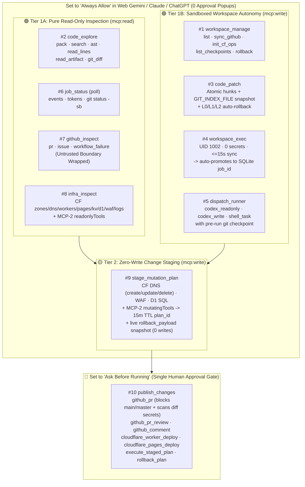

# GeminiBastionMCP (`gemini-bastion-mcp`) — Product Experience, UX Audit & vNext Design Specification

> **Document Status**: Active Product Design & UX Specification (`swarm/ux-design-2`)  
> **Synthesized By**: `@design-copy-2` (Product Designer & UX Copywriter) & `@ux-sim-2` (Simulated End-User & Experience Tester)  
> **Codebase Baseline**: Verified line-by-line against `src/`, `docker/`, `site/`, `DESIGN.md`, `README.md`, `README.zh-CN.md`, and `.env.example` (`MCP 2025-11-25 Streamable HTTP`, Node.js `>= 22.23.4`).

---

## 1. Executive Summary & Code-Truth UX Baseline

`GeminiBastionMCP` (`gemini-bastion-mcp`) solves one of the highest-friction problems in modern AI engineering: turning web and mobile AI chat interfaces (`gemini.google.com` Connected Apps, Claude.ai Custom Connectors, ChatGPT Connectors, Cursor, and MCP Inspector) into a **sandboxed full-stack coding, `@openai/codex-sdk` background runner, and Cloudflare/MCP-2 operations agent** without drowning the user in 40+ tool approval popups or exposing raw infrastructure secrets.

### 1.1 Inventory of the 5 Live UX & Protocol Surfaces

| # | UX Surface | Source of Truth in Code | Current UX Role & Guardrail Invariants |
| :--- | :--- | :--- | :--- |
| **1** | **10-Tool Stateless Streamable HTTP Contract (`ALL /mcp`)** | `src/mcp/server.ts`<br>`src/mcp/tools/workspaceTools.ts`<br>`src/mcp/tools/execRunnerTools.ts`<br>`src/mcp/tools/infraPublishTools.ts`<br>`src/mcp/outputGuard.ts` | Stateless `WebStandardStreamableHTTPServerTransport` (`sessionIdGenerator: undefined`); rejects legacy `GET`/`DELETE /mcp` HTTP+SSE with `405`. All outputs pass through `SecretScrubber`, optional `<<<BEGIN_UNTRUSTED_DATA>>>` anti-prompt-injection boundary wrapping (with spoofing neutralization at `src/mcp/outputGuard.ts:63-67`), and UTF-8-safe 60KB head/tail truncation with full output saved to mode `0600` `/data/artifacts/{artifactId}.log`. |
| **2** | **OAuth 2.1 + PKCE (`S256`) + DCR + Upstream IdP Flow** | `src/auth/dcr.ts`<br>`src/auth/authorize.ts`<br>`src/auth/token.ts`<br>`src/auth/upstreamIdp.ts`<br>`src/auth/discovery.ts` | Supports RFC 9728 (`/.well-known/oauth-protected-resource`), RFC 8414 (`/.well-known/oauth-authorization-server`), RFC 7591 DCR (`POST /oauth/register` up to 16 redirect URIs & 500 dynamic clients), 8,192-byte OAuth `state` (`MAX_STATE_BYTES`), RFC 8707 resource audience binding, 60-second refresh token rotation grace window (`OAUTH_REFRESH_GRACE_SEC`), and fail-closed Google/GitHub operator OAuth login. |
| **3** | **Zero-Leakage Public Gateway Portal (`GET /`)** | `src/mcp/landingPage.ts`<br>`src/app.ts:122-159` | Serves a dark-mode status landing page (or structured JSON when `Accept: application/json` is sent) with 1-click `/mcp` URL copy, `.well-known` metadata links, 10-tool tier badges, and `/admin` entry. Enforces strict SHA-256 script CSP (`LANDING_PAGE_CSP`) and **never queries or exposes private workspaces, jobs, OAuth clients, or tokens**. |
| **4** | **Mobile Operator Cockpit PWA (`/admin` & `/admin/login`)** | `src/admin/index.ts`<br>`src/admin/ui.ts` | Standalone mobile-installable PWA (`manifest.webmanifest` + `sw.js`) protected by `ADMIN_PASSWORD_HASH` (or Google/GitHub allowlisted OAuth) + signed session & CSRF cookies. Displays a 4-KPI Pulse Strip (`Active Jobs`, `Staged Plans`, `Workspaces`, `OAuth Sessions`), 1s SSE live job stream (`/admin/api/jobs/stream`), process-group job termination (`Kill`), non-destructive git checkpoint rollback (`Rollback`), OAuth client/token revocation, and scrubbed audit logs. |
| **5** | **Bilingual Interactive Architecture Showcase (`site/`)** | `site/index.html`<br>`site/favicon.svg` | Static GitHub Pages portal featuring a bilingual (`EN / 简体中文`) toggle, 4-stage architecture visual, interactive 10-tool tier filter, and static interactive mockups of `GET /` and `/admin`. |

---

## 2. End-to-End Simulated Persona Walkthroughs & Top 5 Onboarding Friction Points

To stress-test the real developer and operator experience, `@ux-sim-2` and `@design-copy-2` simulated three target personas end-to-end against the actual implementation:

- **Persona A — "Mobile Web Gemini Power-Coder"**: Senior Full-Stack Engineer on a train commute connecting `gemini.google.com` (Connected Apps) over Cloudflare Tunnel (`docker/docker-compose.yml`), syncing a private repository (`workspace_manage`), running multi-file `code_patch` + `workspace_exec`, and approving a single `publish_changes(action="github_pr")` prompt on mobile.
- **Persona B — "Multi-Client AI Operator (Claude.ai + ChatGPT + Cursor)"**: Indie builder connecting Claude.ai Custom Connectors and ChatGPT Connectors via OAuth 2.1 DCR / Static Client fallback, and configuring Google/GitHub Upstream IdP for one-tap login on `/oauth/authorize` and `/admin/login`.
- **Persona C — "Cloudflare & Bastion SRE"**: DevOps engineer staging DNS/WAF/D1 mutations (`stage_mutation_plan` -> `publish_changes`), federating an `ops-mcp` SSH sidecar on internal `ops_net` (`--profile ops`), and monitoring `@openai/codex-sdk` background jobs from the `/admin` Mobile PWA.

### 2.1 First 60-Second Onboarding Friction Audit (Code-Verified)

#### Friction 1 (P0 Multi-Client Blocker): Claude.ai & ChatGPT OAuth DCR Redirect URIs Fail Closed by Default
- **Code Location**: `src/mcp/server.ts:29-34` vs. `src/config.ts:6-12`, `.env.example:26`, and `src/auth/dcr.ts:23-97,213-220`.
- **What Breaks**:
  - `README.md:7,25,216` prominently advertises: *"Automatic DCR: Point Claude.ai Custom Connectors, ChatGPT, or MCP Inspector directly to `https://mcp.yourdomain.com/mcp`."*
  - In `src/mcp/server.ts:29-34`, `STATIC_ALLOWED_MCP_ORIGINS` explicitly allowlists browser `Origin` headers for `https://gemini.google.com`, `https://aistudio.google.com`, `https://claude.ai`, and `https://chatgpt.com`.
  - **However**, in `src/config.ts:6-12` (`DEFAULT_ALLOWED_REDIRECT_HOSTS`) and `.env.example:26`, `OAUTH_ALLOWED_REDIRECT_HOSTS` defaults only to:
    ```text
    gemini.google.com,aistudio.google.com,accounts.google.com,localhost,127.0.0.1
    ```
    (plus hardcoded Google callback hosts `oauth-redirect.googleusercontent.com` and `vertexaisearch.cloud.google.com` in `src/auth/dcr.ts:72-93`).
  - When Persona B connects Claude.ai or ChatGPT, `POST /oauth/register` rejects their callback URL via `isAllowedRedirectUri()` (`src/auth/dcr.ts:213-220`) with:
    `400 {"error":"invalid_redirect_uri","error_description":"Disallowed or invalid redirect_uri: ..."}` — without naming `OAUTH_ALLOWED_REDIRECT_HOSTS` or listing the currently permitted hosts.
- **Required Fix**:
  1. Provide a ready-to-copy multi-client `OAUTH_ALLOWED_REDIRECT_HOSTS` preset including `claude.ai,chatgpt.com,chat.openai.com` in `.env.example`, `README.md`, `README.zh-CN.md`, and `site/index.html`.
  2. Upgrade the DCR 400 error message in `src/auth/dcr.ts:217` to explicitly guide the operator to `OAUTH_ALLOWED_REDIRECT_HOSTS`.

#### Friction 2 (P0 Deployment Trap): Root `.env` vs. `docker/.env` Split-Brain Leaves `cloudflared` Without `TUNNEL_TOKEN`
- **Code Location**: `README.md:129-157` vs. `docker/docker-compose.yml:28-30,78`.
- **What Breaks**:
  - Quick Start Steps 1–3 instruct the operator to `cp .env.example .env` in the repository root and populate `CLOUDFLARE_TUNNEL_TOKEN`.
  - Step 4 suddenly mentions placing `CLOUDFLARE_TUNNEL_TOKEN` in `docker/.env`, and Step 5 runs `docker compose -f docker/docker-compose.yml up -d --build`.
  - Because Docker Compose resolves `${CLOUDFLARE_TUNNEL_TOKEN}` (`docker/docker-compose.yml:78`) relative to the compose file directory (`docker/.env`) unless `--env-file .env` is passed — while `gateway` mounts `env_file: ../.env` (`docker/docker-compose.yml:29`) — any operator who puts all variables in root `.env` and runs Step 5 gets a healthy `gateway` container and a failing `cloudflared` container with `TUNNEL_TOKEN=""`.
- **Required Fix**:
  - Standardize every Docker Compose invocation across docs and UI copy to:
    ```bash
    docker compose --env-file .env -f docker/docker-compose.yml up -d --build
    ```
    so a single root `.env` drives both `gateway` (`env_file: ../.env`) and Compose variable substitution (`${CLOUDFLARE_TUNNEL_TOKEN}`) with zero file duplication.

#### Friction 3 (First-45s Setup Friction): Two Separate `node -e` One-Liners, `$` Escaping Warnings & Bare-VPS Node Dependency
- **Code Location**: `README.md:134-142,158`, `.env.example:17-23`, `site/index.html:970-975`.
- **What Breaks**:
  - Operators must copy, edit, and run two separate `node -e` commands and manually splice the outputs into `.env`, while reading multiple warnings about legacy `scrypt$...` vs. `scrypt:...` Docker Compose `$` interpolation.
  - On a fresh production VPS that only has Docker installed (no host Node.js 22 runtime), `node -e` fails immediately with `command not found`.
- **Required Fix**:
  - Provide a single unified shell snippet that generates both `ADMIN_PASSWORD_HASH=scrypt:...` and `OAUTH_SIGNING_SECRET=...` in one shot, alongside a zero-host-Node Docker fallback (`docker run --rm node:22-bookworm-slim node -e ...`).

#### Friction 4 (Mental Model & Security Boundary Precision): "Tier 1: Sandbox & Read-Only" Contradicts Local Write Tools & Scope Enforcement
- **Code Location**: `README.md:64,96-108`, `src/mcp/landingPage.ts:313-324`, `site/index.html:794,1017-1148`, `src/mcp/tools/workspaceTools.ts:366-368,719`, `src/mcp/tools/execRunnerTools.ts:237,347`, `src/utils/exec.ts:310-360`, `src/core/validationPipeline.ts:371`, `src/core/codexRunner.ts:440-467`, `src/mcp/tools/infraPublishTools.ts:205-212`.
- **What Breaks**:
  1. **Naming vs. Behavior**: Labeling Tools 1–8 as `"Sandbox & Read-Only"` confuses security-conscious operators because Tool #1 (`workspace_manage: sync_github/rollback`), Tool #3 (`code_patch`), Tool #4 (`workspace_exec`), Tool #5 (`dispatch_runner: codex_write/shell_task`), and Tool #6 (`job_status: cancel=true`) mutate files and execute commands inside `/workspaces/{slug}`, and enforce `requiredScope: 'write'` (`mcp:tools` or `mcp:write`) in `withMcpGuardrails`.
  2. **Dual-UID Precision**: In code, `workspace_exec` (`src/core/workspaceExec.ts:261`) and background `shell_task` (`src/mcp/tools/execRunnerTools.ts:73-74`) pass `uid: config.sandboxUid` (`1002`) to `startSubprocess()`, which drops privileges via `sudo -n -H -u #1002` (`src/utils/exec.ts:310-360`). However, `validationPipeline.ts:371` (`runLinterStep`) and `codexRunner.ts:440-467` (`@openai/codex-sdk`, using `CODEX_HOME=/data/codex` in `docker/Dockerfile:153`) currently run under the gateway UID (`1001`) while relying on `buildSandboxedEnv()` secret stripping and Codex SDK's `workspace-write` sandbox mode.
  3. **Cloudflare Staging Scope Accuracy**: `stage_mutation_plan` (`src/mcp/tools/infraPublishTools.ts:205-212` & `src/core/cloudflareService.ts:140-173`) implements **5 concrete Cloudflare mutation types** (`dns_record_create`, `dns_record_update`, `dns_record_delete`, `waf_rule_update`, `d1_sql_mutation`) plus `downstream_mcp` (`mutatingTools`). It does **not** implement KV writes or Worker route/secret staging as loosely claimed in `DESIGN.md:198`.
- **Required Fix**:
  - Split Tier 1 cleanly in UX copy into **Tier 1A (Pure Read-Only Inspection — `mcp:read`)** and **Tier 1B (Sandboxed Workspace Autonomy — `mcp:write`, 0 secrets, auto-checkpointed, 0 external writes)**, state the exact 5 Cloudflare staged mutation types, and specify uniform UID 1002 privilege drop for `validationPipeline` in the vNext engineering spec.

#### Friction 5 (Operator Login & Consent UX): Silent Empty-Password 401 & Opaque Scope Jargon on `/oauth/authorize`
- **Code Location**: `src/auth/crypto.ts:104-110`, `src/auth/authorize.ts:153-160,429-447`, `src/admin/index.ts:198-217`.
- **What Breaks**:
  1. When `ADMIN_PASSWORD_HASH` is blank in `.env`, `verifyPassword()` (`src/auth/crypto.ts:109`) returns `false` for all inputs, causing `/admin/login` and `/oauth/authorize` to display `"Invalid operator password."` instead of alerting the operator that `ADMIN_PASSWORD_HASH` has not been configured.
  2. The `/oauth/authorize` consent card (`src/auth/authorize.ts:154-159`) displays raw technical fields (`Client ID`, `Redirect Origin`, `Scope: mcp:tools`, `Resource`) without summarizing the 10-Tool / 1-Gate blast radius or offering 1-tap approval when an active `/admin` session cookie is already present in the browser.

---

## 3. Code-Truthful 4-Subtier Permission & Blast-Radius Architecture

To eliminate cognitive dissonance while preserving the **"10 Tools, 1 Approval Gate"** workflow, all product copy, `GET /` portal cards, `/oauth/authorize` consent summaries, and `site/index.html` explorer cards should use the following code-verified 4-subtier model:



### 3.1 Complete 10-Tool UX & Security Contract Reference Table

| # | Tool Name | Subtier & Client Policy | MCP Annotations (`readOnly` / `destructive` / `openWorld`) | Required OAuth Scope (`outputGuard.ts`) | Sandbox, Checkpoint & Blast-Radius Guarantee in Code |
| :-: | :--- | :--- | :---: | :---: | :--- |
| **1** | `workspace_manage` | **Tier 1B**<br>`Always Allow` | `false` / `false` / `false` | `read` (`list`, `init_cf_ops`, `list_checkpoints`)<br>`write` (`sync_github`, `rollback`) | Clones/syncs repos strictly inside `/workspaces/{slug}` (`resolveWorkspaceRoot`), detects stack & `AGENTS.md`/`CLAUDE.md`, and creates a `pre-rollback:<id>` safety checkpoint before every `rollback`. |
| **2** | `code_explore` | **Tier 1A**<br>`Always Allow` | `true` / `false` / `false` | `read` | Strictly read-only (`repomix`, `rg`, `ast-grep`, `read_lines`, `read_artifact`, `git_diff`). Automatically excludes `.env*`, `*.pem`, `*.key`, `id_rsa*`, `id_ed25519*`, and `.dev.vars*`. |
| **3** | `code_patch` | **Tier 1B**<br>`Always Allow` | `false` / `false` / `false` | `write` | Creates non-destructive `GIT_INDEX_FILE` checkpoint (`refs/mcp-checkpoints/chk_*`), runs L0 (placeholder/conflict/secret/AST check) + L1/L2 linters/tests, and restores byte-exact backups on failure. |
| **4** | `workspace_exec` | **Tier 1B**<br>`Always Allow` | `false` / `false` / `false` | `write` | Runs in `/workspaces/{slug}` with `buildSandboxedEnv()` (zero gateway secrets) and UID `1002` (`SANDBOX_UID`). Waits up to `12s–15s` synchronously; auto-promotes longer processes to background SQLite `job_id`. |
| **5** | `dispatch_runner` | **Tier 1B**<br>`Always Allow` | `false` / `false` / `false` | `write` | Launches async `@openai/codex-sdk` (`codex_readonly`, `codex_write` with pre-run checkpoint) or UID `1002` `shell_task` with duration/token budgets and webhook notification. |
| **6** | `job_status` | **Tier 1A / 1B**<br>`Always Allow` | `false` / `false` / `false` | `read` (poll)<br>`write` (`cancel: true`) | Streams incremental events (`since_seq`), token usage, live `git status -sb`, and `final_report_text`. `cancel: true` triggers `AbortController` + process-group kill (`SIGTERM` -> `SIGKILL`). |
| **7** | `github_inspect` | **Tier 1A**<br>`Always Allow` | `true` / `false` / `true` | `read` | Read-only Octokit inspection of PRs, Issues, and failed Actions logs. Every response is scrubbed and wrapped in `<<<BEGIN_UNTRUSTED_DATA>>>` markers. |
| **8** | `infra_inspect` | **Tier 1A**<br>`Always Allow` | `true` / `false` / `true` | `read` | Uses `CLOUDFLARE_READONLY_API_TOKEN` (fallback `CLOUDFLARE_API_TOKEN`) for read-only Cloudflare inspection (`zones`, `dns_records`, `workers`, `pages`, `kv_namespaces`, `d1_databases`, `waf_rules`, `worker_tail_logs`) + MCP-2 `readonlyTools`. |
| **9** | `stage_mutation_plan` | **Tier 2**<br>`Always Allow` | `false` / `false` / `false` | `write` | Snapshots live Cloudflare state into `rollback_payload` for `dns_record_create`, `dns_record_update`, `dns_record_delete`, `waf_rule_update`, `d1_sql_mutation`, or stages MCP-2 `mutatingTools` with 15m TTL (`plan_id`). **Performs zero external writes.** |
| **10** | `publish_changes` | **Tier 3**<br>`Ask Before Running` | `false` / `true` / `true` | `write` | **The ONLY external mutation exit**: `github_pr` (blocks `main`/`master`/default branch, runs L0/L1 validation & diff secret scan), `github_pr_review`, `github_comment`, `cloudflare_worker_deploy` (preview default), `cloudflare_pages_deploy`, `execute_staged_plan`, `rollback_plan`. |

---

## 4. vNext UX Blueprints & Wireframe Specifications

The following five blueprints address the top missing real-world operator workflows identified in `@ux-sim-2`'s simulation while staying 100% aligned with the Hono + SQLite + server-rendered HTML/PWA architecture in `src/auth/` and `src/admin/`.

### 4.1 Blueprint A: Humanized `/oauth/authorize` Operator Consent Card (`src/auth/authorize.ts`)

**Problem**: Currently, `renderConsentHtml()` (`src/auth/authorize.ts:74-175`) shows raw metadata rows (`Client ID`, `Redirect Origin`, `Scope: mcp:tools`, `Resource`) and requires re-typing the operator password even if the operator already has a valid `/admin` session cookie (`readAdminSessionCookie`).
**Design Upgrade**:
1. Add a **Scope Downgrade Selector** (`Full Sandbox & Staged Ops (mcp:tools)` vs. `Read-Only Inspection Only (mcp:read)`).
2. Render a clear **3-Bullet Blast-Radius Contract Box** below the metadata table so the operator knows at a glance what the connecting AI client can and cannot do.
3. If `readAdminSessionCookie(c, config)` is valid, show a 1-tap **`[Approve as Signed-In Operator]`** primary button (still protected by per-request `csrf_token` and `MCP_AUTH_BIND_COOKIE_NAME`) without requiring password re-entry.

```text
+-----------------------------------------------------------------------+
|  [OAuth 2.1 + PKCE (S256)]                                            |
|  Authorize Gemini Connected Apps                                      |
|  Approve MCP gateway access for this AI client.                       |
|                                                                       |
|  +-----------------------------------------------------------------+  |
|  | Client ID        dcr_7f3a9c1e...                                |  |
|  | Redirect Origin  https://oauth-redirect.googleusercontent.com   |  |
|  | Resource (8707)  https://mcp.yourdomain.com/mcp                 |  |
|  +-----------------------------------------------------------------+  |
|                                                                       |
|  Permission Scope                                                     |
|  (•) Full Sandbox & Staged Ops (mcp:tools)   [Recommended]            |
|      🟢 Tools 1–8: Edit/test inside isolated /workspaces (0 secrets)  |
|      🟡 Tool 9:    Stage 15m TTL Cloudflare / MCP-2 plans (0 writes)  |
|      🔴 Tool 10:   Request publish_changes (keep on "Ask" in client)  |
|  ( ) Read-Only Inspection Only (mcp:read)                             |
|      🔒 Allows code_explore, job_status, github_inspect, infra_inspect|
|         Physically blocks all workspace edits, exec, and mutations.   |
|                                                                       |
|  Operator Verification                                                |
|  [_____________________ Operator Password _____________________]      |
|                                                                       |
|  [        Deny        ]   [      Authorize Client ->      ]           |
|  -------------------------- or 1-tap IdP --------------------------   |
|  [           Approve with Google (allowlisted email)            ]     |
|  [           Approve with GitHub (allowlisted account)          ]     |
+-----------------------------------------------------------------------+
```

### 4.2 Blueprint B: Actionable `/admin` Mutation Plans Tab (`src/admin/ui.ts:488-497`)

**Problem**: When an AI agent runs `stage_mutation_plan`, `/admin` increments `Staged Plans` in the KPI strip and renders `summary_diff_text` in the `Mutation Plans` tab — **but offers zero buttons**. Operators reviewing a DNS/WAF/D1 diff on their phone cannot approve, reject/expire, or roll back the plan from `/admin`.
**Design Upgrade**:
- Add three CSRF-protected admin endpoints in `src/admin/index.ts` (wired via injected callbacks in `src/app.ts`, preserving `src/admin/`'s zero-import decoupling from `src/core/`):
  - `POST /admin/api/plans/:id/execute` -> Executes a `staged` non-expired plan and records `actor: "admin"` in `audit_logs`.
  - `POST /admin/api/plans/:id/discard` -> Immediately expires/discards a `staged` plan before its 15m TTL elapses.
  - `POST /admin/api/plans/:id/rollback` -> Invokes `rollbackExecutedPlan()` using the stored `rollback_payload` snapshot.

```text
+-----------------------------------------------------------------------+
|  cloudflare:dns_record_update · plan_8c14e2a9        [ STAGED · 12m ] |
|  Created: 2026-11-21 03:10:12 · Expires in: 12m 18s (Rollback Ready)  |
|  +-----------------------------------------------------------------+  |
|  | - A api.example.com -> 198.51.100.10 (proxied=true, ttl=1)      |  |
|  | + A api.example.com -> 198.51.100.42 (proxied=true, ttl=1)      |  |
|  +-----------------------------------------------------------------+  |
|  [  Discard Plan  ]                        [ Approve & Execute Plan ] |
+-----------------------------------------------------------------------+
|  cloudflare:waf_rule_update · plan_3a90f1b2          [   EXECUTED   ] |
|  Executed: 2026-11-21 02:54:00 · Snapshot: Available                  |
|  +-----------------------------------------------------------------+  |
|  | Updated zone WAF ruleset (2 rules)                              |  |
|  +-----------------------------------------------------------------+  |
|                                            [ ⏪ Rollback to Snapshot ]|
+-----------------------------------------------------------------------+
```

### 4.3 Blueprint C: Enriched `/admin` Live Job Card with Final Report & 1-Tap Checkpoint Rollback (`src/admin/ui.ts:327-350`)

**Problem**: `renderJobs()` in `src/admin/ui.ts:337-348` only displays `j.command_or_objective` plus the last 6 events (`(j.events || []).slice(-6)`). It never displays `j.final_report_text` (where `CodexSdkRunner` writes the structured JSON completion summary and changed files!) or `j.checkpoint_id`.
**Design Upgrade**:
1. Render `j.checkpoint_id` and `j.codex_thread_id` in the job metadata header with a 1-tap **`[⏪ Rollback Workspace to Pre-Job Checkpoint]`** button when `j.checkpoint_id` is present.
2. Render a dedicated collapsible **`Final Report`** section whenever `j.final_report_text` is non-empty.
3. Show event count `(Showing last 6 of N events)` with a `[Show All Events]` toggle.

```text
+-----------------------------------------------------------------------+
|  acme-api · codex_write                              [  COMPLETED  ]  |
|  job_9f42c1a8 · Thread: thr_88a1 · Checkpoint: chk_1763694012_4a1b     |
|  Tokens: 18,420 (in 14,100 / out 4,320) · Duration: 42.3s             |
|  +-----------------------------------------------------------------+  |
|  | Objective: Fix rate-limiter race condition and run L0/L1 tests  |  |
|  | --- Recent Events (6 of 14) ---                                 |  |
|  | [#12 status] Created checkpoint chk_1763694012_4a1b             |  |
|  | [#13 codex]  Patched src/auth/rateLimit.ts                      |  |
|  | [#14 status] Completed (exit=0)                                 |  |
|  +-----------------------------------------------------------------+  |
|  | Final Report:                                                   |  |
|  | Summary: Fixed sliding-window counter reset & verified 18 tests.|  |
|  | Files Modified: src/auth/rateLimit.ts, tests/rateLimit.test.ts  |  |
|  +-----------------------------------------------------------------+  |
|  [⏪ Rollback to chk_1763694012_4a1b]      [Copy Thread ID] [Expand]  |
+-----------------------------------------------------------------------+
```

### 4.4 Blueprint D: `/admin` Integration Readiness Matrix & Setup Health Banner

**Problem**: Operators currently discover missing tokens (`GH_TOKEN`, `CLOUDFLARE_API_TOKEN`, `CODEX_API_KEY`) or missing `claude.ai`/`chatgpt.com` redirect hosts only when a tool call fails mid-chat.
**Design Upgrade**:
- Add an **Integration Readiness Card** at the top of the `/admin` `OAuth` (or `System`) tab exposing boolean readiness pills (never exposing raw secret values!):

| Capability / Integration | Env Var Checked (`src/config.ts`) | Healthy Badge | Degraded / Unconfigured Hint |
| :--- | :--- | :--- | :--- |
| **Operator Password Auth** | `ADMIN_PASSWORD_HASH` | `🟢 Configured (scrypt)` | `🔴 Unset — set ADMIN_PASSWORD_HASH (scrypt:...) in .env` |
| **OAuth Redirect Allowlist** | `OAUTH_ALLOWED_REDIRECT_HOSTS` | `🟢 8 hosts (Gemini, Claude, ChatGPT, Local)` | `🟡 Gemini-only default — add claude.ai,chatgpt.com for multi-client DCR` |
| **GitHub Integration** | `GH_TOKEN` | `🟢 Connected (sync, inspect & PR gate)` | `⚪ Not set — github_inspect & publish_changes(github_*) disabled` |
| **Cloudflare Read-Only** | `CLOUDFLARE_READONLY_API_TOKEN` / `CLOUDFLARE_API_TOKEN` | `🟢 Connected (infra_inspect)` | `⚪ Not set — Cloudflare infra_inspect disabled` |
| **Cloudflare Write & Deploy** | `CLOUDFLARE_API_TOKEN` | `🟢 Connected (stage & publish)` | `🟡 Read-only mode — set CLOUDFLARE_API_TOKEN for deploys/mutations` |
| **Codex SDK Runner** | `CODEX_API_KEY` / `OPENAI_API_KEY` | `🟢 Ready (model: gpt-5.3-codex)` | `⚪ Not set — dispatch_runner(codex_*) disabled; shell_task available` |
| **Downstream MCP-2 Sidecars** | `DOWNSTREAM_MCPS_FILE` / `JSON` | `🟢 N server(s) federated` | `⚪ None configured (optional --profile ops)` |
| **Webhook Notifications** | `NOTIFY_WEBHOOK_URL` | `🟢 Enabled (scrubbed POST)` | `⚪ Not configured (optional)` |

### 4.5 Blueprint E: Zero-Node 1-Command Bootstrap & Post-Deploy Smoke Verification

To cut first-time deployment from 10 minutes to 90 seconds on any machine (even a fresh Linux VM without Node.js installed locally):

```bash
# 1. Clone & create root .env
git clone https://github.com/Kaiserunix/gemini-bastion-mcp.git
cd gemini-bastion-mcp
cp .env.example .env

# 2. Generate BOTH ADMIN_PASSWORD_HASH (scrypt:) and OAUTH_SIGNING_SECRET in one command
#    (Uses the Node 22 Docker image so zero host Node.js installation is required!)
docker run --rm node:22-bookworm-slim node -e '
  const c = require("node:crypto"), s = c.randomBytes(16).toString("hex");
  const h = c.scryptSync(process.argv[1], s, 32, { N: 16384, r: 8, p: 1 }).toString("hex");
  console.log("ADMIN_PASSWORD_HASH=scrypt:" + s + ":" + h);
  console.log("OAUTH_SIGNING_SECRET=" + c.randomBytes(32).toString("hex"));
' 'replace-with-your-operator-password'

# 3. Launch with --env-file .env so BOTH gateway and cloudflared read the single root .env
docker compose --env-file .env -f docker/docker-compose.yml up -d --build

# 4. 10-Second Post-Deploy Smoke Check (verifies DB WAL, RFC 9728, and RFC 8414 discovery)
curl -fsS https://mcp.yourdomain.com/healthz
curl -fsS https://mcp.yourdomain.com/.well-known/oauth-protected-resource
curl -fsS https://mcp.yourdomain.com/.well-known/oauth-authorization-server
```

---

## 5. Comprehensive Error-Message, Empty-State & Microcopy Rewrite Specification

Every rewrite below preserves strict fail-closed security (zero secret leakage) while replacing generic protocol errors with actionable operator remediation:

| Surface & Exact Code Location | Current Implementation Copy | vNext Human-Centered & Actionable Copy |
| :--- | :--- | :--- |
| **OAuth DCR Redirect URI Rejection**<br>`src/auth/dcr.ts:214-220` | `Disallowed or invalid redirect_uri: ${String(item)}` | `Redirect URI "${String(item)}" is not permitted. Allowed redirect hosts: ${config.oauthAllowedRedirectHosts.join(', ')} (plus Google Connected Apps callbacks). To connect Claude.ai or ChatGPT, append claude.ai,chatgpt.com to OAUTH_ALLOWED_REDIRECT_HOSTS in .env and restart gateway.` |
| **Unconfigured vs. Wrong Operator Password**<br>`src/auth/authorize.ts:442`<br>`src/admin/index.ts:211` | `Invalid operator password. Please try again.` / `Invalid operator password.` | **When `!config.adminPasswordHash`**: `Operator password login is not configured. Set ADMIN_PASSWORD_HASH (scrypt:<salt>:<hex>) in .env or sign in with an enabled Google/GitHub operator account.`<br>**When hash is set**: `Incorrect operator password. Verify your password or use an enabled upstream Google/GitHub account.` |
| **OAuth Scope Insufficient Error**<br>`src/mcp/outputGuard.ts:319-321` | `Error: insufficient_scope — "${effectiveScope}" operation requires "mcp:tools" or "mcp:write" scope (granted: ${scopes.join(' ') || 'none'}).` | `Error: insufficient_scope — This session is authorized for read-only inspection (granted: "${scopes.join(' ') || 'none'}"). Tool action requires "mcp:tools" or "mcp:write" scope. Re-authorize the client on /oauth/authorize with Full Sandbox & Staged Ops access.` |
| **Cloudflare Write Token Missing**<br>`src/core/cloudflareService.ts:453,466` | `Cloudflare write operation requires CLOUDFLARE_API_TOKEN (readonly token cannot perform writes).` | `Cloudflare write blocked: CLOUDFLARE_API_TOKEN is not configured in .env (only CLOUDFLARE_READONLY_API_TOKEN is present). Add a write-scoped CLOUDFLARE_API_TOKEN to stage/execute Cloudflare mutations or deploy Workers/Pages.` |
| **Ambiguous Patch Hunk Error**<br>`src/core/codePatcher.ts:137` | `Ambiguous patch in "${relPath}": found ${matches.length} matches at lines ${matches.join(', ')}. Provide more context anchors or a line_hint.` | `Ambiguous patch in "${relPath}": found ${matches.length} matches at lines ${matches.join(', ')}. Pass line_hint: ${matches[0]} (disambiguates within ±25 lines) or include 2–3 surrounding unchanged lines in "search".` |
| **Oversized Output Artifact Offload Notice**<br>`src/mcp/outputGuard.ts:138-149` | `... [OUTPUT TRUNCATED: ${totalBytes} UTF-8 bytes exceeded ${maxBytes} byte inline limit (${omittedBytes} bytes omitted from middle). Full scrubbed output saved to artifact "${artifactId}". Use code_explore(mode="read_artifact", artifact_id="${artifactId}") to read the middle sections.] ...` | Keep exact `artifact_id` callout and append offset hint: `Use code_explore(mode="read_artifact", artifact_id="${artifactId}", offset=25000, limit=25000) to page through the omitted middle section.` |
| **`/admin` Empty Jobs State**<br>`src/admin/ui.ts:333` | `No jobs recorded.` | `No background jobs yet. Commands in workspace_exec running >15s and dispatch_runner (codex_readonly, codex_write, shell_task) stream live here.` |
| **`/admin` Empty Workspaces State**<br>`src/admin/ui.ts:365` | `No workspaces registered.` | `No workspaces synced yet. In your AI client, run workspace_manage(action="sync_github", slug="my-app", repo="owner/repo") to clone an isolated workspace.` |
| **`/admin` Empty Mutation Plans State**<br>`src/admin/ui.ts:492` | `No mutation plans.` | `No staged infrastructure plans. Use stage_mutation_plan to preview Cloudflare (DNS, WAF, D1) or MCP-2 changes with a 15-minute TTL and automatic rollback snapshot.` |
| **`GET /` Public Portal Quick-Connect Cards**<br>`src/mcp/landingPage.ts:294-308` | Generic connection instructions without permission tier advice. | Add explicit 1-Gate setup tip: `After connecting, set Tools 1–9 to "Always Allow" for zero-popup coding and keep Tool #10 (publish_changes) on "Ask Before Running".` |

---

## 6. Six Existing Code-Verified Hidden Gems to Elevate in UX & Product Positioning

Our code audit confirmed six high-value engineering capabilities already built and tested in `src/` that are currently undersold or buried in technical prose:

1. **Zero-Index-Mutation Git Time Machine + Pre-Rollback Safety Checkpoints (`src/core/gitSnapshot.ts:169-350`)**
   - Every `code_patch` and `codex_write` copies `.git/index` to a temporary `GIT_INDEX_FILE`, stages tracked and untracked files (excluding secrets and `node_modules`), writes a tree/commit to `refs/mcp-checkpoints/chk_*`, and leaves the developer's real `.git/index` and `HEAD` completely untouched.
   - **Hidden Gem**: Calling `rollbackToCheckpoint()` automatically creates a `pre-rollback:<checkpointId>` safety snapshot first (`src/core/gitSnapshot.ts:321-330`) — meaning **even an accidental rollback is 100% reversible**.

2. **In-Memory Anti-Lazy-Placeholder & Secret Guard + Polyglot L0/L1/L2 Auto-Rollback (`src/core/validationPipeline.ts:46-290,438-589`, `src/core/codePatcher.ts:288-311,452-456`)**
   - Before writing a patch, L0 rejects lazy LLM truncation placeholders (`// ... existing code ...`, `// ... 保持不变`, `# ... rest of file ...`), unresolved merge markers (`<<<<<<<`), hardcoded secrets (AWS, GitHub, OpenAI, Stripe, Slack, Google, private keys, and dynamic `SecretScrubber`), and TypeScript/JSON AST syntax errors with exact `line:col` diagnostics.
   - L1 automatically runs the appropriate fast linter (`biome`, `ruff`, `gofmt`/`go vet`, `shellcheck`, `hadolint`, `yamllint`, `actionlint`, `tofu fmt`), and if validation fails when `rollback_on_failure` is active, `code_patch` immediately restores byte-exact in-memory file backups.

3. **15-Second Sync-to-Async Job Promotion + Orphan Crash Reconciliation (`src/core/workspaceExec.ts:282-357`, `src/core/codexRunner.ts:623-659`)**
   - Fast commands (`<=12–15s`) return inline immediately for snappy chat iteration. If a build or test suite runs past `wait_ms`, the live process is **not killed** — its stdout/stderr listeners are seamlessly re-bound to a background SQLite job (`job_*`) streaming over SSE to `/admin`, and `reconcileOrphanJobs()` cleans up interrupted jobs on container restart.

4. **Live Pre-Change Cloudflare State Snapshotting (`src/core/cloudflareService.ts:779-960`)**
   - `stage_mutation_plan` queries Cloudflare's live API *at staging time* before any mutation occurs, storing the previous DNS record or WAF ruleset inside `rollback_payload_json` alongside a human-readable diff and 15-minute TTL so `publish_changes(action="rollback_plan")` can restore prior state in one call.

5. **Anti-Prompt-Injection Spoofing Neutralization & Out-of-Workspace UTF-8 Artifact Slicing (`src/mcp/outputGuard.ts:63-95,155-240`)**
   - Any external content containing spoofed `<<<BEGIN_UNTRUSTED_DATA` or `<<<END_UNTRUSTED_DATA` markers is neutralized (`<<<_BEGIN_UNTRUSTED_DATA`) before wrapping, and outputs >60KB are sliced without corrupting multi-byte UTF-8 characters while storing full logs in `/data/artifacts` (verified outside `/workspaces` by `canonicalizeWithAncestor` in `src/config.ts:163-192`).

6. **Web Gemini OAuth 2.1 Edge-Case Compatibility Engine (`src/auth/authorize.ts:18`, `src/auth/dcr.ts:8-17,72-93`, `src/auth/token.ts:433-486`)**
   - Purpose-built for `gemini.google.com` Connected Apps: 8KB `state` storage, 16 redirect URIs per client, path-traversal-hardened `oauth-redirect.googleusercontent.com/r/*` matching, and a 60-second refresh token rotation grace window (`grace_expires_at`) that prevents concurrent mobile browser tabs from triggering false-positive token-family theft revocation.

---

## 7. Prioritized vNext Engineering & UX Roadmap

| Priority | Item | Target Files | Impact |
| :---: | :--- | :--- | :--- |
| **P0** | **Multi-Client OAuth Redirect Preset & Actionable DCR 400 Error** | `.env.example`, `src/config.ts`, `src/auth/dcr.ts` | Eliminates immediate DCR 400 failure when connecting Claude.ai or ChatGPT. |
| **P0** | **Uniform UID 1002 Privilege Drop for Validation Pipeline** | `src/core/validationPipeline.ts:371` | Threads `uid: config.sandboxUid, gid: config.sandboxGid` into `runLinterStep` subprocesses so L1/L2 linters run with the same UID 1002 isolation as `workspace_exec`. |
| **P0** | **Single `.env` Docker Compose Launch & 1-Command Secret Generator** | `README.md`, `README.zh-CN.md`, `site/index.html` | Prevents `cloudflared` empty `TUNNEL_TOKEN` trap via `docker compose --env-file .env -f docker/docker-compose.yml up -d --build`. |
| **P1** | **Actionable `/admin` Mutation Plans Tab (`Execute` / `Discard` / `Rollback`)** | `src/admin/index.ts`, `src/admin/ui.ts`, `src/app.ts` | Enables true mobile-first approval and rollback of staged Cloudflare/MCP-2 plans directly from the `/admin` PWA. |
| **P1** | **`/admin` Job Card Final Report + Pre-Job Checkpoint Rollback Button** | `src/admin/ui.ts:327-350` | Surfaces `final_report_text` and 1-tap `checkpoint_id` rollback directly on completed/failed Codex & shell job cards. |
| **P1** | **Humanized `/oauth/authorize` Blast-Radius Card & Scope Downgrade Toggle** | `src/auth/authorize.ts` | Explains the 10-tool/1-gate contract at consent time, distinguishes unset vs. wrong `ADMIN_PASSWORD_HASH`, and allows `mcp:read` downgrade. |
| **P2** | **`/admin` Integration Readiness Matrix & Workspace Dirty-Tree Badge** | `src/admin/index.ts`, `src/admin/ui.ts` | Shows instant health status for GitHub, Cloudflare RO/RW, Codex, Webhooks, and Downstream MCP-2 sidecars without leaking secrets. |
